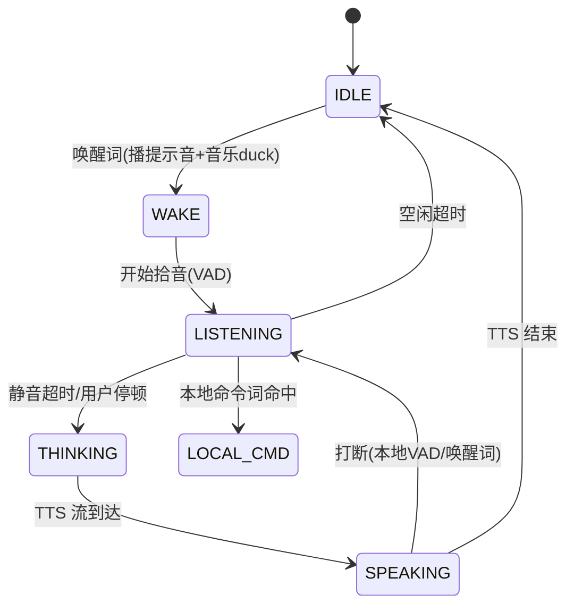

# EspCube 详细设计(软件架构 · 音频引擎 · 模块接口)

> 版本:v1.0(2026-11-08) | 上游文档:《01_技术方案.md》
> 本文是固件实现的依据:模块边界、接口契约、数据流、任务/内存预算、引脚分配。

---

## 1. 系统总览

```mermaid
flowchart LR
    subgraph 音源层
        BT[A2DP Sink\n手机蓝牙 44.1k]
        NET[ICY/HTTP 流\nMP3/AAC 电台]
        TTS[AI TTS\nOpus→PCM 24k]
        UI0[UI 提示音\nbeep]
    end
    subgraph 音频引擎 AudioEngine
        MIX[软件混音器\n48k/16bit/2ch\n每通道独立增益]
    end
    subgraph 输出/回采
        DAC[I2S TX → ES8311 → NS4150B → 喇叭]
        REF[AEC 参考\n48k→16k 降采样]
    end
    subgraph 语音前端 Voice
        MIC[I2S 数字麦 16k]
        AFE[esp-sr AFE\nAEC/NS/VAD]
        WAKE[WakeNet10\n你好小智]
        MN[MultiNet mn7_cn\n本地命令词]
    end
    subgraph AI 云端
        XS[xiaozhi 协议客户端\nWS + Opus\n(自建 server + GLM)]
        GLM[GLM-Realtime 适配器\n(预留)]
    end
    subgraph UI
        LV[LVGL 9 @60Hz\n460×460 CO5300 QSPI]
    end
    BT --> MIX
    NET --> MIX
    TTS --> MIX
    UI0 --> MIX
    MIX --> DAC
    MIX --> REF --> AFE
    MIC --> AFE --> WAKE --> MN
    WAKE --> XS
    MN -->|本地指令| MIX
    XS --> TTS
    XS -->|MCP/事件| LV
    MIX -->|PCM 抽样| LV
```

核心思想:**混音器是全机音频的单一汇聚点**。所有音源(蓝牙/网络/TTS/提示音)都是混音器的一个通道;AI 说话时对音乐通道做 ducking(音量闪避);混音器最终输出同时送给 DAC 与 AEC 参考通道,保证"边放边听"的回声消除正确。

---

## 2. 软件分层与模块清单

```
┌────────────────── 应用层 ──────────────────┐
│  app_ui      app_player     app_ai_session │
│  (LVGL页面)   (音源管理)      (AI状态机)     │
├────────────────── 服务层 ──────────────────┤
│  app_audio(mixer)  app_voice  app_bt       │
│  app_net           app_power(桩)            │
├────────────────── 驱动层 ──────────────────┤
│  drv_display  drv_audio   boardcfg        │
├────────────────── 公共层 ──────────────────┤
│  cubecore(事件总线/环形缓冲/日志/工具)      │
└───────────────────────────────────────────┘
```

| 模块(component) | 职责 | 对外接口(核心) |
|---|---|---|
| `cubecore` | 事件总线(异步发布/订阅)、无锁环形缓冲、通用工具 | `cube_event_*`、`cube_ringbuf_*` |
| `boardcfg` | 全部引脚/外设配置集中地(唯一可改处) | `board_pins.h`、Kconfig |
| `drv_display` | CO5300 QSPI 初始化、TE 同步、亮度寄存器 | `drv_display_init()` |
| `drv_audio` | ES8311(esp_codec_dev)、I2S TX/RX、功放使能、静音时序 | `drv_audio_open/write/read`、`drv_audio_pa_set()` |
| `app_audio` | **混音器引擎**:通道管理、增益/ducking、重采样入口、AEC 回采抽头 | `audio_mixer_*`、`audio_source_*` |
| `app_player` | 音源实现:ICY/HTTP 流播放器、提示音;TTS 源由 app_ai 注入 | `app_player_start(url)`、`app_player_stop()` |
| `app_bt` | A2DP Sink + AVRCP(播放控制/元数据)→ 注册为 mixer 通道 | `app_bt_start()`、回调上报状态 |
| `app_net` | WiFi STA 管理(STA+BT 共存)、断线重连 | `app_net_start()` |
| `app_voice` | esp-sr:AFE(麦+AEC参考)→ WakeNet → MultiNet;唤醒/命令事件 | `app_voice_start()`、事件订阅 |
| `app_ai_session` | AI 对话状态机 + Opus 编解码 + 协议适配器(xiaozhi / GLM-Realtime) | `ai_session_*`、TTS PCM → mixer 通道 |
| `app_ui` | LVGL 9 集成(60Hz、TE)、页面(播放/语音/状态)、频谱可视化 | `app_ui_start()` |
| `app_power` | 电量上报接口(原型桩,最终板接 CW2015) | `app_power_get_level()` |

**依赖原则**:上层只依赖下层接口头文件;跨层事件一律走 `cubecore` 事件总线(如 `CUBE_EVT_WAKE_DETECTED`、`CUBE_EVT_TRACK_META`),禁止模块间直接回调纠缠。

---

## 3. 音频引擎详细设计(核心)

### 3.1 时钟与格式契约

| 项 | 契约 |
|---|---|
| 引擎主时钟 | **48 kHz / 16-bit / 双声道**,以 I2S TX 为节拍(驱动层 DMA 欠载回调驱动混音节拍) |
| 音源接入 | 各音源自行转换到 48k:A2DP 44.1k→48k(软件多相重采样,优化项:硬件 ASRC);TTS 24k mono→48k stereo 复制 |
| 帧粒度 | 混音以 **10ms(480 samples/ch)** 为单位,抖动小、CPU 友好 |
| 缓冲 | 每通道环形缓冲 ≥ 200ms(蓝牙 300ms 抗抖),位于 PSRAM;DMA 描述符缓冲在内部 SRAM |

### 3.2 混音与 ducking

```
每 10ms:
  out[ch] = Σ (src[ch][i] × gain_c)      // Q15 定点饱和加法
  通道增益由 ducking 状态机驱动:
    AI 说话开始 → 音乐类通道 300ms 淡降至 -14dB → AI 结束 → 500ms 恢复
    (提示音/系统音不 duck;AEC 参考取 ducking 之后的最终输出,保证回声模型正确)
```

### 3.3 AEC 回采参考(边放边听的关键)

- 混音器输出复制一份 → 立体声下混为单声道 → 48k→16k 降采样 → 写入 `app_voice` 的参考环形缓冲(即 esp-sr AFE 的 R 通道)。
- 参考信号必须与扬声器实际输出**同源**(取 ducking 后、功放前的最终信号),AEC 才能消掉"音乐回声",让唤醒词/VAD 在放歌时仍能听见人声。
- 原型阶段参考路径 = 软件回采(混音器抽头);最终板若选 TAS5805M 可改 SDOUT 硬件回传(见《01》§1.7)。

### 3.4 欠载/过载保护

- 输出欠载(DMA 快空):重复上一帧 + 事件上报(UI 显示缓冲进度),禁止输出裸 0 导致"咔"声(用短淡出)。
- 通道过载(生产快于消费):按通道策略丢弃/暂停(蓝牙丢旧帧,网络流暂停拉取)。

---

## 4. 显示与 UI 设计

| 项 | 设计 |
|---|---|
| **性能红线** | **全屏刷新稳定 30fps**(最坏情形整屏脏区+电台并发播放下连续 10min 动画实测, perf monitor ≥30 无掉帧尖峰);带宽 101.6Mbps → **PCLK≥40MHz QSPI 为硬性要求**, 20MHz 仅点亮过渡(≈23.6fps 上限不达标);挑战 60fps |
| 渲染 | LVGL 9 + `esp_lvgl_port`;任务固定 core1、优先级 5;`tick` 用 LVGL 定时器 |
| 刷新 | **全帧双缓冲**(2×460×460×2B≈846KB,PSRAM,DMA 直访——`psram_dma_direct`,S31 PSRAM 专用控制器不与 LCD 争带宽):坐标天然偶对齐(CO5300 硬约束)、无撕裂;代价是 PSRAM 带宽占用大(实测会拖慢解码 21 倍),**接屏后需复测与解码的并发** |
| 撕裂 | CO5300 窗口坐标**必须偶数对齐**(LVGL flush 回调里对齐处理);TE 引脚同步(esp_lcd_co5300 IO 回调挂 TE) |
| 亮度 | 面板寄存器 0–255,UI 设置页可调;AMOLED 深色主题省电 |
| 页面 | **极简氛围 UI(2026-11-11 定稿,取代传统三页)**:整屏即动画舞台——电台/纯音乐=一条随音频跳动的发光直线(频谱);BT 音乐有歌词=歌词动画(当前行 24px 渐入/下一行预示,直线弱化为底部衬底);待机=直线呼吸。上下滑动调音量(HUD),左右滑动切曲目/电台(toast)。启动页:立方体自旋+标题渐入 2.4s |
| 频谱 | 混音器抽 256 样本 → 256 点 FFT → 40 带 log 域压缩 + 高带倾斜补偿(音乐能量天然集中低频,不补偿高频纹理不可见);攻快放慢平滑;30fps |
| 直线渲染 | 自绘 AA 光栅器(距离场覆盖率)双笔刷:9px 辉光 + 逐列 3px 垂直 AA 芯线,画在 460×220 ARGB 画布由 LVGL 合成;单路径场景比启用 ThorVG(`LV_USE_VECTOR_GRAPHIC`)更省 CPU/内存 |
| 手势 | 全屏 PRESSING 点位追踪 + 轴向锁定(±14px 判定):垂直→音量实时(全程≈222px 扫 0-100),水平松手位移>60px→切曲。不用 `LV_EVENT_GESTURE`(仅在松手时给方向,无连续音量) |
| 流畅动画 | UI 状态过渡全部 lv_anim+缓动(ease_out 渐入上滑/ease_in 渐出),不手工插值;歌词翻行/音量 HUD/toast 均 timeline 化 |
| UI 开发流 | **PC 模拟器同源编译**(sim/, LVGL9.6+SDL2, ui_model.h 快照边界):UI 代码在 PC 调好直接上板,详见 sim/README.md |
| 歌词飞行动画 | 新句从随机边缘方向 ease_out 飞入中心(越近越慢),旧句沿同方向 ease_in 加速飞离,每句随机倾角 ±4~13°;直线在歌词场景完全让位 |
| ⚠ LVGL 9.6.0 坑 | ①歌词 label 旋转的离屏 layer 分配:设备 sdkconfig 必须 `CONFIG_LV_USE_STDLIB_MALLOC=CLIB`(默认 BUILTIN 是 64KB 池,歌词 layer ~90KB 会分配失败→该句不渲染,模拟器已踩);②rotation+opa 动画叠加触发离屏渲染缺陷(argb8888_row_checked 崩),飞行只做位移不叠淡出;③label 完全出屏时旋转 layer 裁剪区退化→出发/终点钳制在屏内 |

---

## 5. 语音 AI 设计

### 5.1 前端管线(app_voice)

```
数字麦(16k/16bit) ─┐
AEC参考(16k)      ─┼→ esp-sr AFE(SR模式, 10ms帧) → WakeNet10("你好小智")
                    │        ↓ 唤醒
                    └→ MultiNet mn7_cn(本地命令词:音量+/−/暂停/下一首/电台)
```

- 输入格式 `MMR`(M=麦, R=参考);AEC 用全双工模式(播放音乐时拾音)。
- 本地命令词命中 → 直接发事件给 mixer/播放器,**不进云端**(离线可用、零延迟)。
- 需要自然语言/点歌 → 走 AI 会话上行。

### 5.2 AI 会话状态机(app_ai_session)



- 音频:xiaozhi 协议 = **Opus 16k/mono/60ms 帧**(esp_audio_codec opus encoder)WS 二进制上行;下行 TTS opus 解码 → 24k PCM → 重采样 48k → mixer TTS 通道。
- 事件(文本 JSON):`listen start/stop`、`stt`、`tts start/stop/sentence_start`、`llm`(表情→语音页)、`mcp`(JSON-RPC 工具调用:设备端实现 `set_volume/play_station/...`)、`abort`(打断)。
- 适配器接口(`ai_backend_t`):`connect/hello/send_audio/send_text/abort/on_event`——xiaozhi 与 GLM-Realtime 各实现一份,状态机不变。
- **打断(barge-in)**:SPEAKING 中本地 VAD 强触发 → 发 `abort` → 停止下行渲染 → duck 恢复 → 回 LISTENING。

---

## 6. 蓝牙设计(app_bt)

- Bluedroid Classic:A2DP Sink(接收手机音频)+ AVRCP 双角色:
  - **CT(Controller)**:拉取曲名/歌手/专辑元数据(`ESP_AVRC_CT_METADATA_RSP_EVT`,v6.1 单属性逐条回调);注册一次性通知 PLAY_STATUS / TRACK_CHANGE,**触发后重注册**(规范语义);
  - **TG(Target)**:接收手机 absolute volume(0-127)→ `audio_mixer_set_master_volume`(0-100,四舍五入互转);本地改音量(语音/UI)经 `CUBE_EVT_VOLUME_CHANGED` 回传 CHANGED(仅当手机已注册通知,避免对未注册端发送)。
- 元数据/通知注册的时机在 **AVRCP CT 连接事件**而非 A2DP 连接事件(A2DP 先建立,过早发 AVRCP 命令因通道未就绪而静默失败,M1.8 实测教训)。
- 数据路径:`a2dp_sink_stream` 语义拿到解码后 PCM(44.1k/2ch/16bit)→ 写通道环形缓冲(app_audio 提供);若栈交付为 SBC 帧,则用 esp_audio_codec 的 SBC 解码器同路径接入(接口不变)。
- 手机侧显示:AVRCP 注册绝对音量与曲目元数据 → 事件总线上报 UI。
- **BT 模式语义(M1.8 定稿)**:A2DP **连接即切 BT 模式**——①播放器挂起电台
  (`bt_pause_gate` 驻留,不拆任务;暂停期被服务器踢线按零失败重开);②**WiFi 停用**
  (`app_net_suspend`,蓝牙独占 2.4G 射频——实测共存调度下 A2DP 存在"劣化积累态"与
  距离衰减,关 WiFi 后 3m 稳定 10min+)。断开 → WiFi 恢复 → 播放器等 IP
  (`app_net_wait_up`)→ 电台原地恢复(数秒缓冲回填静音属预期)。
  发布方(BT 栈任务)只做事件发布,动作在播放/网络任务内完成 —— 蓝牙栈任务严禁阻塞。
- **链路看门狗(M1.8.6)**:1s 定时器判定"连接+AVRCP 播放中+PCM 断流>3s",持续 8s
  主动 `esp_a2d_sink_disconnect`(把人工断开重连自动化)。教训:S31 预览库
  `esp_bt_gap_read_rssi_delta` 事件从不返回且轮询干扰流媒体(M1.8.6 回归,已移除)。
- 与 WiFi 共存:开 `CONFIG_ESP_COEX` 相关配置;A2DP 通道缓冲 300ms 起步;`esp_coex_preference_set(PREFER_BT)`(WiFi 停用后实际无竞争,留作保险)。

---

## 7. 网络设计(app_net)

- WiFi STA:事件驱动连接/重连(指数退避);NVS 存储凭据(首次配网:BLE 或 SoftAP,里程碑3)。
- ICY/HTTP 流读取器(app_player):`http_client` 流式拉取 → 解析 ICY 头(StreamTitle 元数据→UI)→ 按 MP3/AAC 帧喂 `esp_audio_codec` → PCM 48k → mixer 通道。断流自动重连(≤5 次)。
- 电台列表:NVS/JSON 配置(原型内置 2–3 个测试台,如 SomaFM)。

---

## 8. 任务、内存与 CPU 预算

### 8.1 任务表(优先级 0–24,数字大=高)

| 任务 | 核 | 优先级 | 栈 | 说明 |
|---|---|---|---|---|
| audio_mixer(含 I2S 写) | 0 | 20 | 8KB | 实时路径,最高用户优先级 |
| app_voice(AFE/WakeNet) | 0 | 18 | 12KB | esp-sr 建议独立任务(M2) |
| app_bt(bluedroid 自管) | 0 | 19 | — | BT 控制器/栈任务 |
| net/player(WiFi+流) | **1** | 12 | 12KB | 解码任务,M1.5 迁核(core0 被高优任务占据) |
| ai_session(WS+Opus) | 1 | 10 | 16KB | TLS+编解码(M2) |
| ui(lvgl_port) | **1** | 4 | **16KB** | esp_lvgl_port v2.9 任务参数在结构体(Kconfig 无效),UI 默认开启; M1 调试期本地关闭(全帧渲染实测拖慢解码21倍), 接屏后需复测并发 |
| idle/timer 等系统 | — | — | — | — |

### 8.2 内存预算(HP SRAM 512KB 紧张,大块一律 PSRAM)

| 分配 | 位置 | 量级 |
|---|---|---|
| LVGL 双缓冲(全帧) | PSRAM | 2×423KB(=2×460×460×2B) |
| 各通道环形缓冲(4 通道) | PSRAM | ~150KB |
| 解码器工作区(MP3/AAC/Opus) | PSRAM | ~100KB |
| I2S DMA 描述符与缓冲 | 内部 SRAM | ~32KB |
| WiFi/BT 协议栈 | 内部 SRAM | ~120KB(系统) |
| 栈+静态+LVGL对象 | 内部 SRAM | ~120KB |
| esp-sr(启用后,PSRAM为主) | PSRAM ~520KB(WakeNet10 基准) | |

### 8.3 CPU 预算(双核 320MHz)

AFE ~20% 单核(官方实测)、Opus 编码 ~15%、MP3 解码 ~10%、混音 <5%、LVGL 渲染 20–40%(依页面)、WiFi+TLS ~15%。双核分布后有裕量;AI+UI+音频并发为里程碑验证重点。

---

> 实现注记(2026-11-09):网络音源新增 RAW PCM 直通路径(48k/16bit/stereo,零解码)与播放列表轮播;MP3 解码最终采用 libhelix(见《01》§网络音频栈 M1.5 结论)。混音器新增预填充门控(jitter buffer)与欠载自愈。

## 9. 引脚分配(boardcfg/board_pins.h 集中管理)

> 原则:板载音频(ES8311/功放/麦)引脚随开发板原理图,接线前**以官方用户指南核对**;外接屏幕自由分配,优先 SDIO 排针组(GPIO20–25,疑似 GP-SPI IOMUX 域,信号质量好);避开 strapping(GPIO33/34 USB、36/37、60/61)。

| 功能 | GPIO(建议) | 备注 |
|---|---|---|
| QSPI CLK | GPIO20 | SDIO 排针组 |
| QSPI CS | GPIO21 | |
| QSPI D0–D3 | GPIO22/23/24/25 | |
| AMOLED RST | GPIO38 | |
| TE | GPIO39 | 撕裂同步 |
| 触摸 I2C SDA/SCL(预留) | GPIO41/42 | 带触摸批次启用 |
| 板载 ES8311 I2C/I2S/PA_EN | **待核对**(用户指南/原理图) | 唯一待核对项,集中在此表 |
| 板载数字麦 | **待核对** | 同上 |

---

## 10. 代码目录结构

```
firmware/
├── CMakeLists.txt            # 顶层工程
├── sdkconfig.defaults        # 关键配置(320MHz/PSRAM/共存/日志)
├── partitions.csv            # 16MB:nvs/model(预留esp-sr)/factory/ota0/ota1
├── main/                     # 装配层:启动顺序与演示模式
│   ├── main.c
│   ├── idf_component.yml     # 组件依赖(registry)
│   └── Kconfig.projbuild     # 功能开关(VOICE/AI 默认里程碑2启用)
└── components/
    ├── cubecore/  cubecore.h  cube_event_bus.{c,h}  cube_ringbuf.{c,h}
    ├── boardcfg/  board_pins.h  board_config.h
    ├── drv_display/  drv_display.{c,h}
    ├── drv_audio/    drv_audio.{c,h}
    ├── app_audio/    audio_mixer.{c,h}  audio_source.h
    ├── app_player/   app_player.{c,h}(播放任务/解码封装/播放列表)  icy_stream.{c,h}(ICY协议状态机)
    ├── app_bt/       app_bt.{c,h}
    ├── app_net/      app_net.{c,h}
    ├── app_voice/    app_voice.{c,h}          (里程碑2)
    ├── app_ai_session/ ai_session.{c,h}  xiaozhi_client.c  (里程碑2)
    └── app_ui/       app_ui.{c,h}  ui_pages.c
```

---

## 11. 里程碑计划

| 里程碑 | 内容 | 验收 |
|---|---|---|
| **M1 音频+UI 闭环**(本轮代码) | 驱动层 + 混音器 + A2DP + ICY 电台 + LVGL 播放页(频谱/立方体) | 手机蓝牙出声;网络电台出声;UI 流畅、频谱跟随 |
| M2 语音 AI | esp-sr(唤醒/AEC/命令词)+ xiaozhi 客户端 + 自建 server(GLM) | "你好小智"唤醒对话;本地命令词;打断与 ducking |
| M3 完善 | 触摸(如有)/配网/电量/电台管理/设置持久化 | 断电重启自恢复;配网免串口 |
| M4 AI DJ | 播放中插话/点歌/MCP 工具/主动播报 | 放歌时喊命令,AI 插话点歌 |
| M5 最终硬件 | DSP codec 选型板(§1.7)+ 电源/电池 + 箱体 + TC5FC07-04 | 续航实测 ≥6h;DSP EQ 调音 |

## 12. 验收标准(整机)

1. 手机蓝牙连接即播,AVRCP 控制与元数据显示正常;
2. 网络电台稳定播放 ≥2h 不断流;
3. 放歌中喊"你好小智"可唤醒并对话,AI 说话时音乐自动闪避、说完恢复;
4. UI 帧率验收:**最低红线=全刷稳定 30fps**(整屏脏区+电台并发,perf monitor 实测);挑战 60fps;
5. 续航目标(最终板)≥6 小时。
