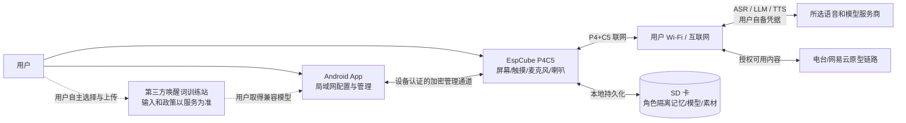
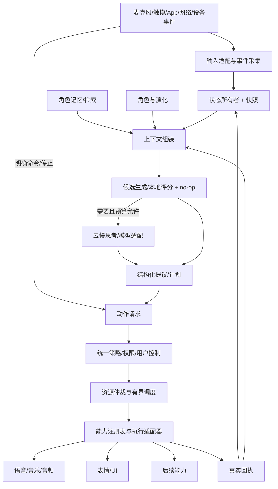

# 17 · 桌面 AI 伙伴系统与软件详细设计

> 版本：设计草案 v1.0｜日期：2026-11-13｜基线：P4C5、ESP-IDF v6.1 原型代码。
>
> 这是**目标设计和接口合同，不是已完成实现**。产品边界见 [16](16_产品需求规格与功能边界.md)，实施顺序与验证见 [18](18_开发计划与任务拆解.md)，当前问题证据见 [15](15_架构与脑科学方案审查报告.md)。本文中的参数初值均为工作假设，要通过实测调整，不能伪装成用户已确认。

## 0. 架构决策摘要

| 决策 | 设计结果 |
|---|---|
| 主线 | 桌面 AI 伙伴；语音、音乐、电台、表情是统一能力目录的执行能力。 |
| 两条轴 | 运行时认知链用 **R0–R5**；源码依赖层用 **S0–S5**，不再用同一 L0–L4 混称。 |
| 所有权 | 状态/会话/动作/存储/音频分别有单一逻辑 owner；网络和回调只投递有界消息，不在同步事件回调做 IO。 |
| 动作 | 用户、App、触摸、会话工具、LLM 自主建议、调试与系统请求共用策略/权限/资源/回执；紧急停止有低延迟控制通路，但不能越过安全边界。 |
| 认知 | 事件与快照 → 候选生成 → 可选慢思考 → 通用校验和选择 → 调用已注册能力；模型可建议参数和短组合，不能注册任意原生代码。 |
| 人格与记忆 | 人格 ID + epoch 隔离源数据、索引、缓存、演化、会话、动作和晚到结果；SD 是长期记忆主存储，缺卡暂不静默回退写入 NVS。 |
| 云与端 | 默认本地动作/状态估计 + 用户配置的云 LLM/语音；网络不可用时提示联网，不承诺离线伙伴。 |
| 手机 | Android 专用 App，设备物理确认、互认证/加密、局域网管理；首次配网与 P4/C5 并发需先实证。 |
| 真实性 | 采纳用户已确认的“自主默认开、勿扰默认不启用”；未测算法/内存/服务可用性标明待测。 |

## 1. 系统边界与部署



- App 不承担设备代请求 LLM 的公网代理；设备直连用户选定的服务。在线唤醒训练是用户允许使用的第三方服务，**不是 EspCube 远程管理后台**。
- 现有固件内的 `app_ncm` 以游客路径通过 HTTPS/weapi 直接请求网易搜索和取址，再交给 `app_player` 拉取上游返回的媒体 URL；**没有发现固件接入独立 Node `ncm-api`**，不必因为 App 局域网管理而引入常驻代理。仓外有独立 Node 项目及测试用临时服务代码，但其实际部署/运行状态未知。源码见 `firmware/components/app_ncm/app_ncm.c:55`、`:156`、`:218`，`firmware/main/ai_skills_setup.c:107`。社区协议不构成正式授权或稳定性保证。
- 数据与信任边界：设备、已认证手机、陌生局域网设备、可拔出 SD、模型输出、内容服务、训练站和云模型均是不同主体；可联网不等于可管理，不可信内容不能直接成为执行权限。

## 2. 分层：行为运行时与源码依赖是两回事

### 2.1 R 轴：运行时语义

| 层 | 职责 | 关键对象 |
|---|---|---|
| R0 观测与反射 | 采集事件、做有限无副作用状态更新；UI 和安全停止尽快响应。 | 输入事件、时间戳、资源状态 |
| R1 状态与上下文 | 维护来源/有效期/不确定性的状态快照，组织角色、当前会话、长期记忆引用。 | `StateSnapshot`、`ContextBundle` |
| R2 候选与快环 | 由事件、上下文、状态产生候选和 no-op；可按简单可测规则评分。 | `Candidate`、`PolicyContext` |
| R3 慢环 | 按预算和事件触发 LLM 解释情境、提议已注册能力参数/有界计划；不是所有请求都需慢环。 | `DeliberationRequest`、`ActionProposal` |
| R4 策略和资源仲裁 | 对所有来源做权限、用户意图、时效、资源、预算及确认检查；同一地点裁定，执行前复检。 | `ActionRequest`、租约、确认令牌 |
| R5 执行与反馈 | 能力适配器接入播放、语音、表情等；返回开始/完成/错误/取消，反馈状态用于未来判断。 | 能力注册、`ActionReceipt` |

这是一套软件组织方式，**不是对神经元全局工作空间、真实意识或生理动机的实现声明**。R0 反射不能跳过 R4；用户可请求紧急停止，不应等待评分或 LLM，但仍经过停止专属、不可被 LLM 取消的资源/权限规则。

### 2.2 S 轴：代码依赖和组件位置

保持 `docs/06` 对基础、驱动、UI 契约和 main 装配的精神，但做以下明确修订：原文“其余只允许向下紧邻一层”和“同层只能用同步广播”不适合复杂业务回执与契约。**新规则：上层只依赖下层稳定公开接口，允许跨越空层；同层不直接 include 对方私有/实现头，交互经向下依赖的契约与注入的端口；无循环依赖。**同步事件总线仅用于小型通知，不代替可靠命令队列。此为目标规范，实施时同步改 `docs/06` 和层检脚本；新表未实施前不能声称旧 checker 能强制新规则。

| S 层 | 组件/拟新增组件 | 对外职责和依赖 |
|---|---|---|
| S0 基础契约 | `cubecore`、`boardcfg`；拟新增/拆出 `cube_contracts` | 公共固定宽度类型、ID、错误码、事件/动作 schema、时间；不得依赖业务实现或云 SDK。 |
| S1 硬件驱动 | `drv_audio`、`drv_display`、触摸/SD 板级驱动 | 封装 P4C5 硬件；无角色、策略或 UI 依赖。 |
| S2 平台服务 | `app_audio`、`app_net`、`app_storage`、`speech_provider`、`app_ncm` 及拟新增 KWS/设备安全服务 | 音频数据面、连接、存储 worker、云协议适配、内容 provider；只依赖 S0/S1 和必要第三方库。 |
| S3 应用/伙伴 | `app_voice`、`app_ai_session`、`app_player`、`app_bt`、`app_soul`、`app_assist`、`persona`、`pair`、`credstore`、`llmprofile`、`sessguard`；拟拆出动作/策略/角色域 | 各服务通过 S0 契约、服务端口和装配注入协作；不通过同层私有头形成网状依赖。提醒保留，不作为首版必交功能。 |
| S4 表现 | `app_ui` 的 LVGL 和 `ui_model`；Android App | UI 只读版本化视图模型并提交命令，不直接控制硬件/播放器；Android 只经管理协议访问设备。 |
| S5 装配 | `firmware/main`、固件依赖绑定和配置 | 注册能力、提供端口实现、建立队列和任务、按依赖启动/失败恢复；不能内嵌大量业务规则。 |

注(2026-11-14 口径勘误): `ai_skills` 为纯注册表, 归 **S2**(与 docs/06 §11、`tools/check_layers.py` L2 一致; 本表原列 S3 为笔误)。`cube_act` 归 **S0**(纯动作契约/注册核心, 无业务依赖)。`drv_touch` 归 S1(板级驱动)。

现有代码组件名是**映射候选**，不强制一次性重命名或无意义拆文件。新组件纳入 CMake 及 `tools/check_layers.py` 层表和未知组件错误规则；检查公开头依赖和 CMake 依赖，不只检查字符串 include。**2026-11-13 修订已落地**: checker `LAYERS` 已登记全部 **24 个分层组件**(第 25 个目录为 vendored mp3_helix, 豁免)、未知组件直接报错(docs/18 T09), 层检绿灯即新架构合规。

### 2.3 运行时组件图



## 3. 数据词汇、来源和全局约束

### 3.1 ID 与信任等级

| ID | 含义及生命周期 |
|---|---|
| `device_id` / 设备公钥指纹 | 一台设备稳定标识及配对锚点；不能只用可伪造的网络名称。 |
| `client_id` | 已配对 App 实例，不等于自然人身份；可撤销。 |
| `persona_id` | 随角色创建生成稳定随机 ID，改名不变；仅创建/确认后生效。 |
| `persona_epoch` | 当前启用角色的代次；每次切换/重载递增。用于拒绝在途旧结果，重启后需使用新的 `boot_id` 联合区分。 |
| `session_id` / `turn_id` | 一次连续会话及各轮；取消/超时后旧结果不可用。 |
| `action_id` / `plan_id` / `idempotency_key` | 动作、计划和幂等标识；去重边界为设备 + 认证主体 + 有限保存窗口。 |
| `data_epoch` / `consent_epoch` | 某角色的记忆修改/撤销代次与授权代次；后台任务结束时重新核对。 |
| `boot_id` / `monotonic_ms` | 用于同一启动周期超时，不能跨重启计算真实时间。 |

`source` 必须区分 `physical_user`、`paired_app`、`voice_unverified`、`model_tool`、`autonomous_local`、`autonomous_llm`、`system_safety`、`debug`。其中语音内容可能表达用户意图但**不证明说话者身份**；模型不能自称 `paired_app`。

### 3.2 状态值及快照

```text
Fact<T> {
  key, value?: T,
  kind: fact | estimate | suggestion | unknown,
  source, observed_at_mono, wall_time?: ISO8601,
  wall_time_trust: unknown | synced | authenticated,
  expires_at_mono?, confidence_note?, version
}
StateSnapshot {
  schema_version, boot_id, snapshot_version,
  persona_id, persona_epoch, session_id?,
  consent_epoch, data_epoch, capability_version,
  values: bounded map<key, Fact<T>>
}
```

- `fact` 仅表示明确测到/确定的设备事实，不表示人类情绪真值；`estimate` 需要记录来源，模型建议是 `suggestion`，不可观测量为 `unknown`。有效期已过视作未知，不赋默认 0 或 1；时间来源不可靠不得伪造日期。
- 状态 owner 串行接收事件，生成有界不可变快照/复制给读者；大对象使用引用计数或固定缓冲代次，生命周期显式。传入事件 payload 需要在回调返回前复制。
- 用户的播放停止、授权撤销和隐私变更是高优先事件，不依赖低优先队列的最后一个槽；拥塞时合并可丢的遥测，不丢终态或取消命令。
- UI 看到的情绪色彩是伙伴内部的**表达态**，不是对用户心理作出判断；没有传感器时不显示虚假的电量/温度/在场。

## 4. 感知、内部状态、快慢思考

### 4.1 统一事件入口

`Event {id, source, persona_id?, session_id?, boot_id, monotonic_ms, wall_time?, payload_version, trace_id}`。允许低频事件通过现有同步总线广播，但回调只做校验、复制并向对应 owner 投递。事件丢失需分类：如音频帧通过数据环，状态可以合并，取消/授权变更/回执则走专门有界队列及超时/溢出报警，不能用 `volatile` 单槽覆盖。

输入类型：唤醒与语音会话、用户控制与显式意图、播放器状态/出声、触摸、网络/时间、SD、能力执行回执、配置/授权、可用的真实硬件传感器。对不具备硬件链路的传感器不造值。

### 4.2 动机与情绪：从最小可测模型开始

- **真实事实**：联网、播放器正在输出、会话状态、用户明确控制、SD 状态等，按来源和有效期管理。
- **工程驱动力**：例如交流机会、表达/兴趣、刺激调节、礼让约束，仅是可配置 0–1 工作量或倾向，不称“饿”“累”。先保留少量已经有可靠输入和验收的维度；未填充的维度为 unknown，不一口气依赖六维或“人工激素”。
- **状态更新建议**：每次 tick 以饱和的有界函数按真实事件增减并温和衰减，记录来源，参数由离线合成数据和小规模试用校准；时间跳变和重启必须有明确上限。没有已验证信号时，候选只按已知因子决策。
- **情绪/表达估计**可保留 valence/arousal 风格的数值，用于措辞与表情，附 `estimate` 来源与 TTL；设备内部变量不等于人的情绪、不代表完整 PAD/OCC。LLM 自报 mood 只是输入建议，不能作为唯一反馈形成自我强化闭环。
- **情境评价**以结构化事件、影响对象、可控性与用户反馈为候选工程模型，未经标注验证不得宣称其识别正确。用户纠正优先于自动推断。

### 4.3 候选生成、评分与 no-op

定义 `Candidate {candidate_id, intent, action_templates[], triggers[], requirements[], evidence_refs[], expires, score_components, persona_epoch, data_epoch, consent_epoch}`。事件响应、角色表达偏好、已注册能力和最近用户行为可独立产出候选；**no-op 永远存在**。凡依赖记忆的快照、候选、云请求、计划和动作都捕获 `data_epoch`，在输出或执行前重新核对；记忆变更时缓存与旧提案失效。

工作初值可使用可解释线性评分，而非任意项为零就吞掉所有信息的无权乘积：

```text
eligible = required_facts_valid && capability_available && policy_precheck
score = bias + Σ(weight_i * normalize(valid_feature_i))
        - disruption_cost - recent_refusal_penalty - resource_cost
```

- 未知项不当作 0 分事实；必须项未知则候选不合格，可选项缺失时只使用声明的缺省策略并记录。用户停止/授权/勿扰不是一个可被高分抵消的权重，是 R4 硬规则。
- 选择可用确定性最高分或带种子的有限随机；工作假设为确定性优先以便复现，随机并非必需。阈值/冷却由配置管理并可在测试中注入单调时间；离线标注/影子模式与真实用户反馈验证，不用 LLM 自称 confidence 当校准概率。
- `no-op` 与执行失败均可解释；启动联网、重连、会话结束这些事件只产生候选，**不得直接播台**。默认自主开但所需服务、授权、资源不满足时，候选被拒绝并显示原因，不偷偷改总开关。
- 工作初值：每类主动声音行为设可配置冷却；系统全局每小时主动音频上限建议 3 次、同类冷却 30 分钟；这些只是防误触发的测试初值，包含开关和诊断，需体验验证，不要求用户逐次批准。用户主动操作后设置动作资源级抑制窗口，具体解除见 §5.5。

### 4.4 点火与慢思考

- 事件显著性、候选不确定性、用户交互、相关记忆、待完成状态变化和剩余预算共同决定是否调用云模型；只有事实来源可用且必要时才构造 `DeliberationRequest`。内部变量 `gap=1-level` 是工程差值，不等于贝叶斯惊奇。
- 门：在线、服务凭据/权限有效、自主未禁用、在途请求数受限、冷却/预算、相关 persona/session/consent 未变化、资源和干扰成本允许。默认工作假设：最多 1 个主动慢思考在途；费用预算和频率由设置控制并有可见拒绝原因。
- 用户当前语音请求可直入对话 LLM，不需等待自主点火；自主与对话共享适配/执行策略但采用独立配额与取消标签。
- 向 LLM 发送的快照只含完成动作所需的最小数据，标明 `fact/estimate/unknown` 和来源；记忆、用户文本、角色草稿、外部内容都属于**不可信数据**。提示分隔能降低混淆但不是权限边界。
- 输出为严格受限的 `ActionProposal`；解析失败、非法数字/NaN、重复键、超长、虚构引用或过期即拒绝。可校验证据 ID 在当前快照/检索授权域实际存在，但引用存在也不能证明结论真实。最终执行由本地 R4 判定。

## 5. 统一行为、能力和执行详细设计

### 5.1 核心契约

```text
CapabilityDescriptor {
  capability_id, schema_version, owner, description,
  input_schema, result_schema, result_semantics,
  risk_class, required_permissions[], required_resources[],
  supports_cancel, interrupt_policy, max_duration_ms,
  availability(snapshot) -> available | unavailable(reason)
}
ActionRequest { /* 以下为网关鉴别后构造的内部对象，不由外部自由赋值 */
  action_id, idempotency_key, origin, principal?,
  persona_id, persona_epoch, session_id?, consent_epoch, data_epoch,
  capability_id, capability_version, parameters,
  cause_event_id?, evidence_refs[], requested_at_mono, expires_at_mono,
  priority_class, resource_claims[], confirmation_token?
}
ActionReceipt {
  action_id, attempt, seq, status, source, reason_code?,
  observed_at_mono, device_effect?, cause_id?, receipt_version
}
PlanProposal {
  plan_id, persona_id, persona_epoch, data_epoch, consent_epoch,
  expires_at_mono, steps[bounded]: {step_id, action, depends_on[], failure_policy}
}
```

示例能力：`speech.say(text, voice, prosody)`、`music.play(source, selection)`、`music.stop(resource_token)`、`face.show(asset_id, duration, style)`、`audio.volume(value)`。具体参数只允许 schema 中定义的有限类型/范围和资产 ID，不能接收任意 URL/文件路径/代码作为高信任指令。可支持组合如 `face.show` 与 `speech.say` 并行，或播放成功后显示表情；扩展能力通过注册 `CapabilityDescriptor + executor` 和策略声明加入。

- **来源与权限不可由请求自封。**公网模型输出、ASR 文本和 App 提交只提供能力 ID、允许的参数及用户侧请求 ID；`origin/principal` 由本机受信输入适配器或已验证的客户端证书确定，`priority_class/risk_class/resource_claims` 由能力注册表和本地策略计算。外部填写这些保留字段一律拒绝或覆盖后审计；不能伪造 `system_safety/physical_user/paired_app`、提高优先级或声明空资源来绕过仲裁。mTLS 证明的是已绑定客户端，不自动证明自然人身份。
- AI 可以提议已注册能力的参数和组合，甚至提出新的**可审查声明配置草稿**；生效前必须校验并取得适用授权。它不能通过配置新能力把任意 native 代码、脚本、网络地址或私有数据访问偷偷纳入运行。
- `PlanProposal` 有界（工作初值：最多 4 步，嵌套/循环禁止，**计划调度窗口**最长 60 秒，真实上限由资源验证）；窗口只约束步骤何时可以启动，不等同于持续音乐或其他执行器的最长播放时长。执行中的能力由各自租约、用户停止及资源策略管理。每步独立执行前复查，不因计划开始时允许就永远允许。部分成功不代表整体回滚；每个副作用如实回执。
- 执行器**必须支持报告能力不可取消或取消中**；请求取消不代表底层已经停止。超时和中断后可用 `unknown_outcome` 反映无法确认的外部副作用，不能自动重复执行有副作用的动作。

### 5.2 生命周期与回执

```text
proposed -> rejected
         -> queued -> accepted -> started -> completed
                                  |        -> failed
                                  |        -> cancel_requested -> cancelled | interrupted | failed | unknown_outcome
                                  -> failed | cancelled
queued/accepted -> cancel_requested -> cancelled | failed | unknown_outcome
```

状态转移由动作 owner 串行维护，`rejected/completed/failed/cancelled/interrupted/unknown_outcome` 是单次尝试终态。可等待中的用户确认单独标为 `awaiting_confirmation`，过期或拒绝即 `rejected`。同一 `principal + idempotency_key + canonical_params_hash` 在**明确的去重保留期**内返回原结果而不执行第二次；有外部副作用的执行至少在执行前持久化意图和去重标记，持久失败则不启动。重启后能验证的记录继续去重；结果未知、记录损坏/缺失或保留期已过时，不自动把旧重试当新动作执行，而返回需要重新确认/新请求。没有持久副作用的易失动作以 `boot_id` 限定，不能宣称无限期或跨重启 exactly-once。

- 音乐 `started` 定义为解码后真实 PCM 已进入并由输出路径确认消费；“建任务成功/请求了 URL/已入混音缓冲”至多是 `accepted`，并不能证明人耳可闻。音频损坏/静音仍需单独诊断；`completed` 是播放按定义结束，用户停止是 `cancelled`/`interrupted`，不是自然完成。
- 说话 `started` 需要 TTS 音频被输出链消费，`completed` 要经对应流排空/播放结束；一次 announce 入队不得回称说完了。脸部动作 `started` 为 UI 已应用指定素材版本的确认；按期限自然结束为 `completed`，被用户/更高优先级动作提前替换则为 `interrupted`。
- 每条回执必须携带执行器/动作 owner `source`；状态变化有原因时必须给 `reason_code`，能关联明确触发请求时必须给 `cause_id`，无相关原因或无法确定时可为空并报告 `unknown`。`accepted` 表示执行器已接收并确认能力可处理，不表示资源输出或用户已感知；`completed` 表示该动作声明的结束条件确实满足，而非一定证明用户满意。用户主动暂停/停止显式标记，不靠“前后 15 秒”猜归因；内容加载失败与用户拒绝不能混淆。日志可存动作类型和匿名 ID，不存文本。
- 冷却从**真实 started** 或策略明确的失败退避开始，不在仅入队时盲记；拒绝、取消和自然结束分别计数。

### 5.3 授权与风险

| 类型 | 例子 | 默认规则 |
|---|---|---|
| 紧急/安全控制 | 立即停当前声源 | 可走低延迟通道；不依赖云/评分，但必须绑定资源并报告结果。 |
| 低风险表达/播放 | 说一句话、表情、选已许可的电台/曲目 | 已注册、当前授权、资源/用户意图允许时可自主运行；自主全局/分类开关生效。 |
| 可恢复配置 | 普通角色风格、动作参数草稿 | 在用户允许范围内演化或用户提交；锁定项禁止覆盖，版本化且可回滚。 |
| 隐私/管理敏感 | 删除记忆、换服务凭据/访问域、设备配对、改变隐私授权 | 已认证 App + 与请求内容/角色/期限绑定的一次性确认；不能凭未鉴别语音或旧记忆获得授权。 |
| 未注册或不可控 | 执行代码、任意文件/网络访问、修改安全策略 | 本版禁止自动执行；新增能力先走开发/配置审核。 |

一次确认 token 由设备在已认证会话中生成并绑定 `client_id、action_id、canonical_params_hash、persona_id/epoch、expiry、nonce`；用户在已配对 App 或约定的可信物理界面查看目标与后果并确认，设备才签发短期令牌。后续请求必须携带令牌，设备在实际执行前原子校验并仅消费一次；参数/角色变化、客户端撤销或超时令牌失效。敏感 DELETE/PATCH/凭据接口也按此协议执行，不因不是 `/actions` 就跳过。能力风险等级不能由模型降低。

### 5.4 资源仲裁和任务执行

- 资源：麦克风 `mic`、扬声器优先音频总线 `audio.foreground/background`、网络带宽/HTTP 连接、播放器实例、显示素材载入和 SD 写入。每项有 owner、容量/兼容矩阵、租约代次、截止时间和释放回执。
- 逻辑优先级（高→低）：安全停止/故障保护；当前用户明确停止/打断；当前用户明确播放/对话；经用户授权的系统事件；自主行为。提醒保留扩展位，不预设会越过勿扰或首版承诺。
- 不同资源可以并发，但必须通过兼容表，例如 TTS 与音乐在混音器支持时可 duck；麦克风只有唯一读 owner 或由单 producer 明确 fan-out，不能两任务直接读同一设备。
- 有界队列、每类最大并发和超时；实时线程禁止文件/网络 IO、动态大块分配、等待 UI 锁。队列满时返回 `rejected:busy` 或合并可丢状态，不能报成功。
- 锁顺序和线程：actor 自有状态不跨 owner 持锁；长 IO 移到 worker；LVGL 只在 UI 任务使用、通过消息或版本化快照；音频数据环和控制队列分离，音频对象生命周期不能跨释放。
- 自动行为不抢占用户明确播放/会话；新用户命令可取消或替换自主动作，资源回收完成才启动会冲突的新动作；失败结果可见，不用强行 stop 返回成功。

### 5.5 用户停止、勿扰和启动规则

- 对用户明确停止，递增目标资源的 `user_intent_epoch`、取消旧队列/计划/在途结果、请求执行器停止，并生成带因果的回执。之后同一资源的旧自主提议即使晚到也失效。
- 工作假设：对该资源保留 `user_stopped` 锁存，跨网络重连和重启保持，直到用户明确重新播放或主动解除；对其他资源不一刀切。先立即停止音频，再异步提交停止意图；持久化失败时向界面报告“当前已停、重启保持未确认”，不能伪报成功。每次启动在恢复并验证独立用户意图配置之前均**不启动自主音频**；配置损坏或不可写保持受影响资源保守静默，允许用户明确操作/修复；待恢复成功后再按自主开关进入正常候选。此策略不把总开关改为关闭，也不自动取消用户命令。是否增加自动解除可在未来体验调优，但不能在重连时复播。
- 自主总开关默认 **on**。关闭时停止新自主请求并取消尚未开始的自主请求；已开始音频/可取消动作按用户设置立即取消并等回执，无法取消则报告；不影响用户主动命令和独立获许可的系统请求。
- 勿扰默认 **off**；启用后按时区和用户配置抑制新自主出声，不停止用户已开启音乐。若启用的时段需要本地时间但时间不可信，仅暂缓受影响的新自主出声；若勿扰关闭，不以“时间未知”制造隐藏的全局禁音。
- 首次启动、网络重连仅发布事件和状态；是否说话/播歌由普通候选产生并通过同一门禁。设备无网时屏幕提示联网，不将本地反射误宣传为离线产品能力。

## 6. 语音、音频与连续会话

### 6.1 所有权与状态机

```text
NET_REQUIRED / SERVICE_UNAVAILABLE  --恢复--> WAKE_WAIT
WAKE_WAIT --目标词/用户触发--> SESSION_START
SESSION_START --> LISTENING --VAD 结束--> PROCESSING
PROCESSING --> SPEAKING --输出完成--> FOLLOWUP_LISTENING
FOLLOWUP_LISTENING --有语音--> PROCESSING
FOLLOWUP_LISTENING --结束/超时--> ENDING --> WAKE_WAIT
任意会话状态 --用户停止/切角色/撤授权/网络失败--> CANCELLING --> ENDING
```

- 唤醒监听 `WAKE_WAIT` 与会话录音 `LISTENING/FOLLOWUP_LISTENING` 分开显示。麦克风硬件不会因“停止会话录音”自动物理关闭；在唤醒等待仍需要监听。临时采样环仅有界保留并及时清除；默认不写录音文件。
- `MicOwner` 是唯一硬件读取者，按明确协商决定 KWS 和 ASR 订阅：简单路径为所有权切换并确认 `lease_id`，需要同时监听时由单一采集任务安全 fan-out；不允许两个应用任务并发拉麦。
- ASR 的 `open/feed/finish/close` 由**同一个 ASR owner 任务**顺序调用，音频通过有界队列发送，超时/关闭双方确认，避免 provider 线程契约冲突。KWS/ASR 切换涉及 AFE 前处理和设备所有权测试。
- 连续多轮的临时上下文含本轮角色、最多若干轮消息、工具请求/回执；工作初值为最近 8 轮、上下文 token 上限由模型 profile 及内存共同约束。超限时可用临时摘要，但不得把摘要擅自写成长期记忆，角色切换/结束后清除。
- 工作初值：跟进监听静默 10 秒超时、单次会话最长 5 分钟、允许用户明确结束；阈值可配置，真实噪声和延迟测量后调整。超时后取消**该会话所属**的 ASR/LLM/TTS 请求与尚未执行的会话动作，释放临时对象并回到唤醒等待或联网提示；不因此停止独立的用户音乐播放。
- 说话/播放时的物理/触摸/App 停止是最低可验证打断路径；免提语音打断依赖 AEC、VAD、KWS/ASR 并发实测，各状态分别标明，不以头文件注释宣称已支持。思考期/播报期有 `cancel_epoch`，旧 HTTP/TTS 回来须丢弃。

### 6.2 声音路径

```text
MIC -> single MicOwner -> KWS (wait) / ASR queue (session)
cloud TTS -> bounded stream -> mixer foreground -> DAC
radio/song -> player/decode -> mixer background -> DAC
mixer reference -> optional AEC adapter (only after integration and measurement)
```

- 保留单一音频混音汇聚；TTS 期间按配置 duck 背景，实际淡入/淡出以资源约束和板测定。切换、打断、末帧排空必须关联相同 `action_id/stream_generation`，防旧尾音或网络重连重新拉起。
- 参考采样仅是现有接口，当前 wake 管线为单麦 `M`，不能称 AEC 已闭环。AEC 是否接入、参考对齐/时延、自身 TTS 自唤醒与真实噪声必须实测。
- 采样率与缓冲大小按实际支持配置，避免把公开 Kconfig 的 16–96 kHz范围等同均已安全；混音数组和 48→16 kHz 路径须统一约束并覆盖边界。PSRAM 与内部 DMA 不能混为一谈。
- 百炼现有 TTS 请求语速/音高是否消费调制 hint 必须以实际 provider 为准；统一 `prosody` 合同声明 provider 支持项，未实现则显示忽略/不支持，不承诺已生效。保留用户此前选定的 `longanrou_v3` 默认目标及男/女预设，服务不可用时明确提示，不静默冒充原音色。

### 6.3 实时语音与级联

先以 ASR→LLM→TTS 级联路径实现可控多轮；Realtime 为可插拔加速路径，仅当其会话、工具、取消、隐私和音频所有权通过相同合同后启用。快线故障转级联时不能重复发送已执行工具、重复播放已确认输出或无提示切换用户未授权的服务商。保留此前快线尾音问题，按功能后集中修复，若影响数据或越权则先隔离。

## 7. 人格、记忆与受控演化

### 7.1 数据模型

```text
PersonaBase {persona_id, version, display_name, description,
  style_constraints, default_voice, allowed_interests?, user_locked_fields[], source}
PersonaEvolved {persona_id, revision, values_by_dimension,
  allowed_bounds, evidence_ids[], created_at, algorithm_version, rollback_parent?}
MemoryRecord {memory_id, persona_id, kind: episode | preference | fact_candidate,
  text_summary, subject: user | companion | unknown,
  source_ref, event_time?, created_at, validity: candidate | confirmed | corrected,
  sensitivity: normal | pending_review | denied, consent_version,
  tombstone?, revision, index_generation}
Consent {persona_id?, memory_enabled, evolution_enabled,
  sensitive_policy, cloud_data_scope, consent_epoch, updated_by}
```

- `PersonaBase`、`PersonaEvolved`、`MemoryRecord` 是三类不同数据：底座设定不等于演化，伙伴兴趣不等于用户偏好，事实候选不等于用户确认。所有持久化对象标 schema、来源、版本和边界。
- 预设卡与自定义卡一律用户确认后生效；AI 草稿为非可信输入，解析、长度、内容审核和用户编辑后才能生成正式卡；不得包含会覆盖系统安全策略的指令。
- 默认没有可认证说话者 ID；由已配对 App 确认或明确用户表述的数据可以标更高来源信任，普通自动提炼为候选并允许纠正。

### 7.2 记忆写入、检索、删除

1. 当前会话发生时先保存在有界易失内存；记忆授权开启且 SD 可写时，异步提炼最小摘要。使用云提炼前明确发送范围和服务商政策；模型输出作为候选而非自动客观真值。
2. 对潜在敏感信息先标 `pending_review`，未确认前不进入默认检索/提示；规则无法保证零漏检，提供浏览和删除。凭据、访问令牌及 Wi-Fi 密码禁止作为记忆。音频不默认落盘，完整逐字日志不默认落盘。
3. 写入线程检查 `persona_id + persona_epoch + consent_epoch + data_epoch` 仍有效，SD/backend 状态和存储配额允许后才提交；切角色、暂停记忆、纠正/删除和撤销时，旧结果丢弃或按可证明策略隔离，不得晚到复活。
4. 使用当前请求关键词与时间/来源等候选因子做**按当前查询**的本地检索，先严格过滤 persona、授权、删除、敏感状态和 TTL，再对合格项排序。首版可使用可测试的中文字符 n-gram 与英文 token 基线；不依赖虚假“字节命中即语义相关”，不强制设备向量模型。
5. `ContextBundle` 将记忆作为带来源 ID 的不可信数据块，权限始终由本地代码控制。用一次记忆不自动提高其真实性；用户纠正/确认与曝光计数分开。
6. 删除或纠正先递增该角色 `data_epoch`，立即撤销旧内容的查询和缓存、取消相关后台任务；最终持久删除按 §8.2 的独立撤销代次/防回退流程执行。若删除或纠正关联源条目使某摘要、演化依据无法干净剥离，废弃并从剩余获准来源重建，旧演化修订仅保留不含被删内容的必要版本元数据；回滚不能复活已删记忆或越过当前用户锁定配置。不能只写入当前槽的墓碑，却允许恢复到含原记录的旧槽。
7. 产品只能承诺通过验证的**逻辑不可再使用、恢复不复活及介质清理操作**；卡的磨损均衡/副本和云服务留存使物理擦除/云撤回不一定可保证。若设计按数据分组加密，删除密钥可能增强保护，但仍需验证密钥副本和其他明文副本，不能自动宣称密码学擦除完成。

### 7.3 切角色屏障

```text
请求切换 -> 限制新请求 -> 增加 persona_epoch/取消代次
 -> 取消旧 LLM/ASR/TTS/待执行计划 -> 清空旧会话和检索缓存
 -> 加载新角色、权限、索引与可用状态 -> 发布新快照 -> 解除屏障
```

- 用户界面显示切换中；已不可撤销的外部副作用如实报告，不能把其计入新角色。收到旧回执只归档到旧作用域，不产生新行动/记忆。
- 不因两个角色共用同一人就共享记忆；未来共享必须是独立授权特性，不在首版默认实现。

### 7.4 演化机制

- 按角色存放有边界的 `EvolvedPreference` 维度：语言表现、动作/表情、伙伴自身话题/音乐兴趣、互动节奏。维度由注册表扩展，不能通过新维度修改安全/隐私/角色锁定字段。
- 候选来自用户明确反馈、执行结果和可追溯的非敏感交互事件；区别“用户直接表示喜欢”与模型推测。用户暂停长期记忆时，不得另借演化历史或诊断日志保留未经授权的对话摘要/偏好事实；演化本身仍按独立授权运行，但只能使用当时获准的非敏感即时信号和已许可资料。不得用单次被动曝光证明喜欢、用点击最大化/留存率作为唯一优化。
- 工作初值：一条低风险候选每个周期只对一个维度产生不超过配置范围 5% 的有界变化，并按一定最小证据数聚合；以离线回归决定参数，不能声称是人格科学常数。记录原值、新值、证据 IDs、原因和模型/算法版本。
- 每个变化写入独立 revision；用户可查看、暂停、恢复或回滚至已保留版本。暂停演化不关闭自主行为，关闭自主也不等于删除已形成的偏好；回滚同时取消基于旧 revision 的在途行动提案并使缓存失效。
- Whole Trait Theory 等心理学仅提供“稳定倾向与情境状态可区分”的启发；不能以 valence/arousal EMA 直接计算大五，也不应宣称形成了人的性格或临床判断。

## 8. 存储、恢复与旧数据迁移

### 8.1 分区与存储内容

| 介质 | 目标内容 | 边界 |
|---|---|---|
| 设备 flash/NVS | 设备配置、身份/配对元数据、用户设置、凭据（经已验证的保护机制） | NVS 容量有限，不默认写长期对话记忆；真实加密能力依目标配置。 |
| SD（长期主存储） | 按 persona 作用域保存加密/受保护记忆及索引、角色演化版本、唤醒模型、EFC 素材。 | 可拔出、不可信；未经确认不格式化。目录和文件格式在实现前定版。 |
| RAM | 当前会话和音频环、短期状态、动作/模型缓冲。 | 有界、所有权明确；结束/切角色/撤授权后释放或清除。 |
| 用户所选云 | ASR 音频、最小必要对话/提炼文本、TTS/模型请求。 | 用途、供应商数据保留、跨境/计费等以当前政策为准；不等于 EspCube 云备份。 |

工作假设目录：`/sdcard/v1/personas/<opaque-id>/memory/`、`.../evolution/`、`/sdcard/v1/wake/`、`/sdcard/v1/face/`。目录名不是访问控制，用户取卡仍可读原始文件，保护依加密和密钥策略；最终格式要具备版本、长度上限、校验/认证和迁移标记，不把 `.jsonl` 扩展名当格式证明。

### 8.2 单写者和可恢复提交协议

设计候选：每个逻辑数据集双槽 `A/B` + 两份带代号/校验的 manifest，**不依赖覆盖式 rename 原子性**。

1. 检查挂载、卡身份、空间、可写状态与授权；旧版本只读，未恢复为 ready 时禁止写。
2. 生成新代完整数据或受限增量，将新记录写入非活动槽，校验版本、长度、条目完整性与内容认证；检查每次 write/flush/close 返回值。必要时重复读回验证。
3. 写入一份带递增 generation、槽 ID、哈希/认证及 commit 标记的 manifest，flush/close 并读回；再更新另一份 manifest。旧槽在新的提交代通过恢复校验前保留。
4. 启动时读两份 manifest 并验证相应完整槽，选择满足协议的最新已提交代；损坏/冲突时进入 `RECOVERY_REQUIRED` 并停止写，绝不把暂时空视图覆盖为真空库。
5. **删除/撤授权是更严格的特例：**双槽恢复必须服从独立防回退删除清单，而非仅信最新 manifest。工作方案将最小 `delete_intent {opaque_persona_id, opaque_memory_id, generation, target_media_id, state}` 和目标介质的撤销代次保存在设备受保护、可恢复的本地控制分区（不是长期记忆副本）；具体介质/容量/密钥保护由 T14/T20 在目标板验证。收到请求后先限制该数据集的读和相关动作，在 RAM 中立即隐藏目标；**只有独立意图持久提交成功，才允许回复 `accepted/deletion_pending`**。无法持久写意图时返回 `rejected:not_durable`，明确告诉用户删除尚未被设备可靠接受；运行期间继续隐藏并提示，断电恢复后不得宣称该请求仍受保护，因为它从未获持久接受。意图提交后逐槽/索引/摘要清除或由防回退清单可靠屏蔽，再提交完成状态；涉及的旧槽即使被恢复，也先应用清单。清理中缺卡、掉电或校验失败则保持 `pending` 并阻止该数据集读取；控制分区不可读、代次倒退或校验失败时 **fail closed，不能把旧槽当正常库**。只有清理范围和撤销代次满足验证才返回 `deletion_completed`；对完整介质回滚/替换攻击的强防回退能力另依硬件安全能力验证，不能凭普通 NVS 自称具备。
6. 双槽、flush 和文件系统并不自动证明断电后所有物理扇区稳定；必须逐步骤注入短写、I/O 失败、掉电、满盘、拔卡、控制分区与 SD 同时不可用和 FAT 元数据损坏，并为实际介质报告结果。容量与写放大以板测确定；必要时改可校验追加日志+定期压实，但保留相同恢复不变量。

`StorageStatus = UNMOUNTED | MOUNTING | READY | READ_ONLY | NO_CARD | FULL | CORRUPT | RECOVERY_REQUIRED | IO_ERROR`。当前为了 hosted 内部 DMA 推迟 SD 初始化的实现需先量测：目标是 Wi-Fi 驱动关键内存预留后不依赖“实际联网成功”即可尝试挂载，若 P4 无法做到则显式状态和重试；不能因为断网就把不可见 SD 当空库。

### 8.3 加密、密钥和日志

- 目标：设备密钥保护云凭据和 SD 记忆内容；采用经审计的认证加密与安全随机数，不自创密码算法；每角色/数据集派生独立密钥并为每次写入生成不复用的 nonce。密钥和加密元数据不可与明文备份混放。
- 当前 P4 装配层对某些 NVS 初始化错误执行整分区擦除（`firmware/main/main.c:122`–`:125`）；在设备身份、凭据或防回退标记使用同一分区之前必须迁移/修正，默认进入恢复或只读状态，不能自动擦除用户配置。
- `esp_hosted` 当前版本的 P4 glue 对 `esp_wifi_remote_set_storage` 忽略参数并直接返回成功（`firmware/managed_components/espressif__esp_hosted/host/wifi_remote_glue/src/esp_wifi_remote_glue.c:173`–`:177`）；这只能证明该 glue 没有转发设置，**不能据此推定 C5 实际凭据是否落盘或已清除**。T03/T17 须以测试凭据验证 C5 存储、换网、删除/恢复出厂路径。P4 的 NVS/flash 加密不会自动保护 C5 和 SD。
- 区分设备闪存加密、NVS 加密、Secure Boot、SD 应用层加密，它们解决的问题不同，**不假定任何 eFuse 或安全功能已开启**。ESP-IDF 文档提示 flash encryption 不自动涵盖所有 NVS，eFuse 和某些发布配置具有不可逆/恢复影响；任何实际熔丝操作/密钥销毁之前单独审查并征得许可。参见 [P4 flash encryption 官方说明](https://docs.espressif.com/projects/esp-idf/en/v6.1/esp32p4/security/flash-encryption.html)。
- 保护等级按实装验证报告：仅软件密钥存放无法抵御拥有固件/物理访问者；如无法安全持久密钥则不得宣传“SD 已受到强物理保护”。若加密密钥失去，SD 加密内容可能不可恢复；先定义可行的本地恢复/用户导出和销毁策略再部署，不承诺云备份。
- 默认日志仅错误码、匿名 ID、状态及水位；不含语音、对话原文、凭据、用户角色敏感内容。诊断导出需明确用户操作和范围，异常转储也须做敏感信息评估。

### 8.4 旧数据与安全迁移

- 旧 `mem/episodes.jsonl` 实际为 TSV，且已有加载字段错位与随后的重写风险。旧数据没有可靠 `persona_id`，不能默认属于任意新角色或分给所有角色；在隔离区作为**未归属**，经用户选择归属后迁移。
- 真实设备/SD 在用户许可前不读取或修改；获得许可后先只读备份到受保护副本，在副本上按旧格式解析、逐字段比对和记录异常。无法还原的已覆盖内容如实标未知，不声称恢复。
- 迁移结果保存新槽并校验，原文件保持只读可回滚；任何步骤失败均不删除/覆盖原文件。对专用副本建立 `legacy_source_hash + row_offset + content_digest → new_memory_id` 的迁移台账，删除后在独立撤销清单中保留不泄露原文的来源标识，禁止相同旧行/备份被重导入后复活；源文件变化或无法匹配时进入待审而非自动归属。隔离区/App 提供来源预览、选择目标角色、确认/中止、错误与幂等状态；**保留原始文件供取证不意味着可以绕过用户删除重新导入**。旧 NVS 的枚举参数、分配失败容量、SD 热挂载去重需以隔离数据和故障注入验证。

## 9. Android 配网、配对与局域网协议

### 9.1 网络引导

1. 初次/换网时用户在 P4 本机触摸入口发起限时配网；设备显示配对码/二维码与当前模式，超时退出。P4 本身不具原生经典蓝牙控制器，不能假定 A2DP/BLE 配网可用。
2. 优先验证 ESP-IDF `network_provisioning` 的 **SoftAP + Security 2（SRP6a + AES-256-GCM）**或经同等评审的成熟协议；二维码携带设备身份指纹/随机配对秘密和版本，不以短数字码的低熵作为唯一安全保证。App 主动连接临时 AP，用户输入 Wi-Fi 凭据；是否能与 C5 hosted 的 STA 同时运行、信道切换和 Android 自动切网需上板验证。
3. App 验证屏幕展示的设备身份；认证密钥交换绑定配对窗口和设备公钥，不在未认证 HTTP 上传送 Wi-Fi/云凭据。Wi-Fi 重连可导致临时 AP 中断，状态应可恢复且避免泄露密码。
4. 同网通过 mDNS 或等价方式发现仅可得到地址和未经认证的提示；App 只信任已经绑定的设备公钥/证书，并验证目标服务身份。

ESP-IDF 通用文档支持 SoftAP 和 Security 2，**不代表当前固件已经启用，也不证明 P4+C5 hosted 组合必然可用**：[官方配网](https://docs.espressif.com/projects/esp-idf/en/stable/esp32p4/api-reference/provisioning/provisioning.html)。若 SoftAP 不可行，先探索已证实硬件支持的等效带外连接，安全目标不降低；这是计划的前置门禁，不自行假装有蓝牙。

### 9.2 首次配对、持续认证与撤销

> **v1 注记(2026-11-18 P3 需求重构)**: 首版按已实现并板验的 pair.h 协议交付(T15, §25)——屏显 6 位 PIN
> 手输 + SRP-6a 交换 + P-256 指纹表(120s 窗口/5 次锁定/物理开窗); 6 位 PIN 不作为唯一安全保证
> (SRP-6a 双向证明+窗口+失败锁定+后续 mTLS 分层缓解, App 侧对接见 docs/18 P3)。
> 本节"二维码+自签证书+高熵引导秘密"作为 **v2 安全/UX 升级路线**保留。

- **首配工作方案**：设备生成长期身份密钥及自签证书，屏幕二维码编码公钥哈希及限时高熵引导秘密；App 在带外读取后验证证书公钥指纹，并在该加密连接内完成挑战/证明，设备要求本机触摸确认。App 生成自己的客户端密钥，设备在已认证会话内绑定其公钥/证书与 `client_id`。配对窗口、尝试次数和速率受限。
- **后续连接工作方案**：局域网 HTTPS/TLS + 双向证书或等效已评审的认证通道；App 固定设备公钥指纹，设备校验已登记客户端公钥、撤销状态和能力范围。不能关闭服务器验证、使用所有设备共用秘密，或把发现结果当认证。
- **时间自举**：未校时会影响公开 CA 服务证书校验；局域网配对在明确物理确认下可对设备身份采用公钥固定，不以临时跳过验证解决。云端 TLS 必须保留证书与主机名校验；经认证 App 可提供时间作为待校准来源，信任等级和安全影响须实现与验证。
- App 私钥放 Android Keystore（实际软/硬保护依设备）；设备密钥使用经过目标板验证的受保护存储。生产级芯片防提取能力不能由 Android Keystore API 或“有加密”单独推断。
- 可撤销指定 `client_id`，撤销后失效其会话和 token；换手机通过设备本机入口重新配对，不能只凭同网 IP 获取权限。丢失全部手机时使用明确设备物理恢复流程；恢复/恢复出厂可能不可逆，必须提供后果说明与确认。

### 9.3 管理接口和数据格式

工作假设采用版本化 HTTPS REST（可选认证 WebSocket 状态推送）；具体传输组件以 P4 并发测量为准。接口是目标合同，不是现有服务器。
**已实现子集(2026-11-18 核; appsim 实测 2026-11-19)**: pair_server.c 已板验 `/v1/pair/step1|step2|step3|bind`
(SRP 配对链)+`/v1/device`(只读)+`/v1/mgmt/creds[/{id}]`+`/v1/mgmt/settings`(mTLS 客户端证书 REQUIRED,
credstore at-rest+412 版本冲突, T15/T17); App v1(配置版)对接此子集, 其余端点随对应功能页交付。
**App 侧合同注意(appsim 实测口径, §55.12)**: ① credstore 版本=全局单调计数(跨条目递增)+删除后
墓碑递增防 ABA——写前必 GET 现值, 断言只可"递增"不可"连续+1"; ② settings 为常驻 blob(承载
llmprofile)拒绝 DELETE(400); ③ 客户端撤销端点(DELETE /v1/clients/{id})未实现, 现经设备 CLI
`pairunbid <id>`(FR-02 过渡口); ④ 网络重试为 App 侧责任(设备端 pair server 串行无读超时,
间歇可能挂起)。完整目标合同:

```text
POST   /v1/confirmations         # 敏感操作摘要 -> 短期 challenge，用户确认后签发令牌
GET    /v1/device                 # 身份、版本、连接/时钟/存储状态
GET    /v1/capabilities           # 可注册动作及 availability
POST   /v1/actions                # 外部请求 DTO：能力 ID、合法参数、请求/幂等 ID
GET    /v1/actions/{id}           # 状态/真实回执，或订阅事件
GET    /v1/personas               # 当前角色和允许的角色列表
POST   /v1/personas/{id}/activate # 切换屏障
GET    /v1/personas/{id}/memory   # 分页、已配对且授权
PATCH  /v1/personas/{id}/memory/{id}  # 纠正，版本检查
DELETE /v1/personas/{id}/memory/{id}  # 需确认，立即逻辑撤销
GET    /v1/settings               # 自主/演化/勿扰/服务状态
PATCH  /v1/settings               # 使用 expected_version 防覆盖
POST   /v1/wake-model/uploads     # 分块、有界、候选槽校验
POST   /v1/wake-model/{id}/activate  # 显式确认、可回滚
DELETE /v1/wake-model/{id}        # 删除用户模型；活动模型先切回内置默认
GET    /v1/migrations             # 合成/获许可的旧数据未归属列表和状态
POST   /v1/migrations/{id}/assign # 已认证用户确认目标角色、版本与可回滚迁移
POST   /v1/service-credentials    # 认证加密通道，写入后只返回已配置状态
DELETE /v1/clients/{id}           # 已认证及额外确认；撤销会话
```

- 每个管理请求携带 `request_id、protocol_version、idempotency_key`；需要时还带 `persona_id/expected_version`。服务端从认证连接绑定的身份得到 `client_id`，自己生成内部 `origin/principal/priority/resources`，**不信任客户端或模型提供的这些字段**，并在需要时补充当前 `persona_epoch/data_epoch/consent_epoch`。动作结果始终通过 `action_id` 查询，WebSocket 是通知而非唯一可靠回执；掉线重连按版本取快照。
- 应答包括 `status、reason_code、retryable、current_version`；分清 `400 invalid`、`401 unauthenticated`、`403 forbidden`、`409 conflict/stale`、`429 busy/rate_limited`、`503 unavailable`。认证和速率限制在解析大型 body 前生效。
- 上传按已登记固定目录/资源 ID，路径规范化，最大大小/总磁盘配额/超时/分块边界受限；设备校验包内容而不执行其脚本。哈希只证明传输完整，模型来源真实性需要签名或用户认可的可信来源策略。
- `service-credentials` 写入不返回原文；变更 endpoint/供应商提示数据流变化并经授权；不得随日志/状态广播。默认不开放公网监听，绑定局域网接口并验证客户端。

### 9.4 App 模块建议

`onboarding`（配网/身份）→ `device-transport`（认证协议/重连）→ `device-repository`（快照/版本）→ `features`（角色、记忆、音乐、自主、唤醒、服务）→ UI。Kotlin + Jetpack Compose 可作为 Android 工程默认，非用户强制指定；需要离线状态仅指 App 上的连接/引导界面，不承诺离线伙伴。版本兼容、权限、前后台恢复及多设备列表均要测试；首版不假设已有 App 仓库。

## 10. 云模型、语音与工具适配

### 10.1 Provider/Model Profile

```text
ProviderProfile {provider_id, endpoint, transport, model_id,
  auth_reference, tls_policy, data_scope, timeout_budget,
  supports_tools, supports_json_schema, supports_stream,
  max_context_tokens, supported_prosody[], profile_version}
```

- ASR、LLM、TTS 分别为接口，默认基线复用现有百炼链路；首版 LLM 支持配置经验证的兼容服务/模型名，兼容不是“任意模型都能稳定 function calling”。不支持严格 schema 的模型走受控解析和安全降级；不能降级为直接执行自由文本。
- 非 system 权限数据包括用户/助手历史、记忆、角色卡内容、检索/电台结果和模型提议。即使放在某个聊天 message 内仍需视为不可信；工具授权不由提示词担保。
- 每个请求带 `session_id/turn_id/persona_epoch/consent_epoch/data_epoch/cancel_epoch/model_profile_version`，回包前后二次核对；超时、取消、模型切换、记忆纠正/删除或授权撤销后结果丢弃。会话工具循环设置次数、token、时间和费用上限，默认记录用量而非内容。
- 模型调用级 `confidence` 不能直接视作经校准概率。离线使用有标注集评估：schema 合法、引用 ID 正确、角色一致、用户意图与行为适切、安全拒绝、自然度；分模型/版本报告，敏感实例使用合成语料，不上传真实对话作为评测。

### 10.2 语音/表情一致性

`ConversationReply` 包含文字内容、可选风格建议、可选动作提议，语速/音高由能力声明与用户偏好共同限制。`MoodSuggestion` 只能作为低权重、可追溯建议，不反过来证明本地估计正确；表情只是表现动作，可由上下文及 AI 共选，不要求模型输出某固定情绪标签才能工作。

## 11. 自定义唤醒词与模型生命周期

### 11.1 原则和模型包

- 用户明确允许第三方在线训练，包括曾讨论的 onnx-wakeword 相关网站；此前要求开源方案需区分**运行时/训练代码/训练服务/模型数据许可**，在线服务的闭源与收费条件不能未经核实等同全部开源。既要支持用户便捷训练，也要记录依赖及数据责任。
- 需要一个在 P4 上通过实测的**具体运行时 + 前处理 + 模型包**组合。可比较现有调研的 voicute/onnx-wakeword 和 microWakeWord，选择通过证据和许可门的路线；不同训练输出可能采用不同 mel 特征、张量形状、状态和算子，不能只以 `.onnx/.tflite` 后缀判兼容。
- 公开原始资料的具体边界：voicute 的 [README](https://github.com/voicute/onnx-wakeword)描述在线输入关键词、可选录音和下载 `model.zip`，**没有证实在线自定义包必含 ESP32 所需的 TFLite 与配对 head**。其[模型示例](https://github.com/voicute/onnx-wakeword/blob/main/models/README.md)另含 INT8 TFLite backbone、配对 `head.h` 和元数据；[ESP32 组件说明](https://github.com/voicute/onnx-wakeword/blob/main/esp32/idf/voicute/README.md)称 S3 已实机验证、P4 有代码路径但未硬件验证，示例 head 编译入固件，不能假定可动态下发。推理代码 MIT 不等于训练管线开源或生成模型可商用；[维护者说明训练暂不开源](https://github.com/voicute/onnx-wakeword/issues/3)，网页当前费用、数据留存及模型分发权未核实。
- [microWakeWord](https://github.com/OHF-Voice/micro-wake-word) 提供 Apache-2.0 训练代码和面向 TFLite Micro 的量化流式模型，但具体训练语料、增强数据、TTS 音色/权重许可证仍须逐项核对；其第三方网站实际流程和收费未验证。ESP-SR 的 [external model path](https://github.com/espressif/esp-sr/blob/master/wakeword_list.md) 是 ESP-SR 模型构建期打包，不是通用 ONNX/TFLite 热加载。ESP-TFLite-Micro 支持目标板的部分路径不保证目标模型算子、前处理与项目 IDF 6.1 完整兼容。
- 包至少含 `manifest_version、model_id、label、runtime_id/version、target、audio_sample_rate/channels、feature_pipeline_id/version、input/output_shape、stream_state_spec、quantization、threshold、operators、size、sha256、license/source`。校验字节长度、算子白名单、内存上限与版本。模型可含元数据，不可携带可执行脚本。
- 一次仅激活一个可用主模型；闪存内置经过验证的 **Hey Cube 默认模型**，SD 中 `active/candidate` 两槽。候选受损/中断时不覆盖上一个可用项；缺卡或两槽均损坏时回退内置模型。内置模型/运行时/分区能否共存是必须上板验证的首版门槛，不得用“显示恢复入口”替代实际可运行的默认词。在线站点产出的权重授权、训练原料和服务可用性都需核验；仅把下载地址交给用户不算设备自定义能力已完成。

### 11.2 链路与门禁

```text
选择词/第三方训练 -> 用户在外部服务提交其所需输入
 -> 用户取得模型 -> 兼容性检测/必要的可信转换与打包
 -> App 导入并显示来源/哈希及可验证的签名状态 -> 设备候选槽传输/校验
 -> 隔离加载 + 资源测试 -> 用户真实试唤醒
 -> 确认激活；失败/断电 -> 上一模型/默认恢复
```

- 首版不要求 App 替用户自动上传资料，不建设自有公网训练后台；如第三方在线站必须提交词、录音或合成训练数据，先告知并由用户自行决定。不同服务收费/等待时间不假设。
- P4 端必须测特征提取一致性、算子、量化、模型 arena、内部 DMA/PSRAM、音频帧间隔、KWS CPU/延迟；分别测安静、播放电台、设备 TTS、真实说话者、多方言/音量与自唤醒。误唤醒/漏唤醒报样本量、小时数和置信区间，不声称零误唤醒。
- 默认 `Hey Cube` 和至少一个用户自定义词均为首版必须验收。站点关闭、模型不兼容或 P4 算子/资源不够 → 记录阻塞、选择有许可的可复现实验路线；不能无提示降为“以后支持”。

## 12. 音乐、电台与内容边界

- `MusicProvider` 对外声明 `search(query)、resolve(item_id)、availability、license_scope、stop` 等能力；播放动作使用 provider 的受控、短期结果，音乐源元数据不是系统指令。HTTP 域名/跳转、TLS、媒体大小、重定向和 MIME 按安全白名单与协议限制处理，避免让 LLM 通过任意 URL 访问局域网服务。
- `app_player` 只负责受控 URL/流解析、解码、混音输入及状态，不负责擅自决定播放。网络电台列表与授权/可用性版本化；用户在 App 或语音选台进入统一行动链。
- 网易云首版是**个人原型路线**：现有代码是设备直连 weapi 的游客搜索/取址，cookie 仅预留接口，未发现登录或调用者；不能因此假定已实现账号/VIP 管理。代码引用的社区逆向协议不自动代表官方 API、用户账号许可或可商业分发。游客可用性、URL 过期及 query 被去除的影响、平台条款和曲库使用权限逐项验证；不得绕过付费、地域或权限限制，也不要求用户在聊天中提供账号/Cookie。
- 当前搜索/取址 HTTPS 配置附证书包；上游返回的媒体可能是 HTTP，而播放器 HTTPS 的证书校验配置需另测。未来适配器应默认验证 HTTPS 证书和主机名；若可用媒体仅为 HTTP，应明确提示明文风险与内容来源，不得谎称链路已加密。禁止在普通日志输出含敏感参数的播放 URL。
- 内容不可用、版权受限、HTTP 错误/地址过期等明确返回失败。没有得到适用授权/条款结论时不声称可合规大规模交付；局域网中间桥接若需要，应经用户明确知晓部署和密钥边界。电台成功不替代网易云点播功能验收。
- 自动推荐或自主播放记录 `origin=autonomous`，受总开关、勿扰、停止锁存、用户资源优先控制；用户点播 `origin=user` 不应被自主勿扰停掉。

## 13. 功耗、资源、并发与故障

### 13.1 资源规划方法

- 板级文档显示 P4C5 16 MB flash、32 MB PSRAM；实际可用内存、内部 DMA、任务栈和分区占用必须读构建产物并在 P4 测量。当前 `partitions-p4c5.csv` 为约 10 MiB factory + 3.5 MiB model，没有双 OTA app 槽，不能承诺 A/B OTA。
- 在任务登记表中集中维护优先级/栈/核，但迁移时以实际 ESP-IDF `StackType_t` 和栈单位为准；用高水位和溢出保护测量，不单靠静态估算。
- 每个工作队列、模型包、会话历史、候选和能力计划均配置最大长度；大缓冲按所有者分配/池化并记录失败，回调不分配大块内存；只读存储 worker 的大缓存不得长期占用内部 DMA 堆。
- 分场景测基线：空闲唤醒；联网电台+EFC；多轮 ASR/TTS；LLM 工具+记忆写；自定义 KWS+音乐+动画；坏网/重试；安卓并发管理。记录 CPU、内部最小空闲/最大连续块、PSRAM、栈、音频欠载、帧时间 P50/P95/P99、请求延时和存储写量；数值上限由试验和发布门确认。

### 13.2 故障行为

| 情况 | 面向用户 | 系统行为 |
|---|---|---|
| 无 Wi-Fi/互联网 | 屏幕提示联网，App 提供配网恢复 | 网络能力 `unavailable`，云请求失败/取消；不承诺离线伙伴，不重播旧动作。 |
| 云服务不可用/限额/鉴权失败 | 显示哪个服务未就绪或需更换凭据 | 不输出伪造成功，不无授权地切服务商；保存已完成本地状态。 |
| 时钟不可信 | 显示状态、通过安全路径同步 | 不伪造事件日期；勿扰开启且涉及时间时暂缓受影响的新自主出声，TLS 不关闭校验。 |
| SD 缺失/满/损坏 | 显示长期记忆暂停或只读及修复指引 | 不自动格式化；不将空视图覆写旧卡；不静默把长期记忆转存 NVS。 |
| 低内存/队列满 | 可解释的繁忙或能力不可用 | 拒绝新低优先负载、保护音频/取消命令，释放租约，不伪报完成。 |
| 唤醒候选模型加载失败 | 提示失败并提供回退 | 维持已验证模型或恢复入口；坏包不得替换当前模型。 |
| 切角色/撤授权/用户停止 | 立即反映操作状态 | 提升代次、取消旧工作，晚到结果不执行；无法取消的副作用如实报告。 |
| 播放失败/源不可用 | 说/显示失败原因 | 回执为 failed，不能把 URL 获取/任务启动称为出声。 |

### 13.3 更新与恢复

- 当前分区不是 OTA 双槽。长用原型至少需安全的版本标识、固件和数据 schema 兼容矩阵、更新前本地数据保护与失败恢复流程；A/B OTA、签名验证及分区迁移是**待设计/待验证**，不作为已实现能力。
- 如启用 Secure Boot/flash encryption，烧录与 OTA 签名、eFuse 一次性操作和设备可恢复性须专项评审；未经独立许可不做不可逆配置。
- 已记录的卡顿、概率黑屏/挂死、快线尾音噪音等按用户安排在功能完成后集中修复和压测；若某项造成数据损坏或越权，则先隔离/修安全最小子集，不提前把全部体验优化变成强制主线。

## 14. 可观测性、验证与完成门

### 14.1 可观测而不泄露

`trace_id` 将事件→候选→策略决定→行动→回执串起来；UI/App 可显示“因为正在会话/用户停止/服务不可用而未执行”等原因类别。计数包括请求、拒绝原因、队列高水位、资源等待、取消、TTFB、输出开始/结束、存储故障、模型选择版本；默认不写用户文本、音频、令牌、完整提示或秘密。

### 14.2 测试分层

1. **静态/合同**：依赖图、协议 schema、公开头与 CMake 一致、敏感日志扫描、许可证清单。
2. **宿主单元**：动作状态机、未知值和有效期、预算/冷却、UTF-8/解析、persona epoch、记忆检索、删除与演化回滚，使用伪时钟与合成文本。
3. **故障注入/并发**：持久化各步断电与短写、内存分配失败、队列满、网络迟到、角色切换、取消同一资源、恶意模型输出及重复请求；ASan/UBSan 和模糊输入。
4. **设备集成**：P4 专用测试卡和测试身份验证音频所有权、输出回执、SoftAP/TLS、存储恢复、EFC/音乐/KWS 负载；Android 多版本真机。真实云/真人/训练需单独授权，先用替身。
5. **产品评价**：代表性合成语料评估不同 LLM 版本的角色一致、动作选择适切、拒绝和引用；经参与者同意的小规模体验验证主动频率、误唤醒/漏唤醒、打断和记忆纠正效果；报告失败及样本，不将模型自评当真值。
6. **长稳**：功能完成、集中修复后执行有网络波动、掉电、存储负载和用户控制的混合运行；记录限制和未覆盖情形。

### 14.3 通过定义

- `docs/18` 为每项能力提供前置任务和可执行门槛；合成回归通过不等于板测/许可已完成。特别地：FR-08 自定义唤醒、FR-19 网易云、FR-24 隔离、FR-25/26 记忆、FR-13–17 动作闭环均不能被演示或模拟替代。
- 安全/数据 P0 未消除不得扩大真实数据试用或开放新增自主行为；默认自主开启应在通过统一门禁后作为首版真实出厂配置，不把测试期隔离开关误称产品默认。
- 最终在 `docs/18` 的需求追踪矩阵逐条记录证据、测试环境与未决风险；没有真实数据/真实服务许可时标阻塞而不是写“完成”。

## 15. 接口示例与可替换性

### 15.1 示例：用户点歌 + 自主表情

```text
1 用户语音（source=voice_unverified）→ ASR 文本 → LLM 提议 music.play(item_id)
2 Policy：普通播放可由语音请求，但 item/provider 须可用；不是凭语音获得管理权限
3 Resource：用户播放优先于自主背景音乐，取消旧租约；创建 action_id=M1
4 music adapter 回 accepted；无真实输出前不对用户说“已开始”
5. 输出链确认首段 PCM 已消费 → M1 started；上下文得到真实回执
6 候选 face.show("music") 经策略、资源、当前 persona_epoch 检查后执行
7 用户触摸/App 停止，或通过已验证可用的语音停止入口发出停止 → user_intent_epoch++，取消 M1/相关计划；不会因重连自启
```

### 15.2 示例：自主说话与表情组合

```json
{
  "plan_id": "example-only",
  "persona_epoch": 7,
  "steps": [
    {"id": "face", "capability": "face.show", "params": {"asset_id": "curious", "duration_ms": 2000}},
    {"id": "speech", "capability": "speech.say", "params": {"text": "想听点音乐吗？", "voice": "persona_default"}}
  ]
}
```

解析和 schema 校验只是第一道门；还需自主开启、授权、勿扰、频率、用户停止、来源 ID、快照有效、资源兼容及各步独立回执。若说话步骤被拒，表情能否单独执行取决于声明的 `failure_policy`；不能因示例有效就允许模型指定任意动作。

### 15.3 新能力接入清单

1. 声明 capability ID/版本、schema、资源、风险、授权、取消、真实回执定义；注册到目录。
2. 实现 executor 和有限的能力可用性查询，不直接操纵其他模块私有状态；支持错误和超时。
3. 配置策略、用户可见控制和 AI 允许的参数空间，明确哪些仅用户发起/需要确认。
4. 添加合成单元、并发、拒绝、取消、过期、回执与 persona 隔离测试；新增能力不应修改通用候选筛选或策略核心。
5. 通过完整验收后开放给自主候选；测试期间的隔离不改变用户选定的首版默认值。

### 15.4 R 轴到 S 轴的可执行调用图

为避免“认知层”只是概念名词，首版按以下逻辑组件拆分。名字是目标边界，不要求一次性新建同名 IDF 组件；每个 owner 的消息与失败语义必须落在公开合同中。同步总线只能提供通知，所有带结果的调用有独立请求/回执。

| 逻辑组件 / 层 | 单一职责 | 接收 → 产出 | 状态与失败边界 |
|---|---|---|---|
| `EventIngest` S0/S3、R0 | 复制输入并规范来源/时间 | 硬件、App、云和执行器事件 → `Event` 投递 | 不阻塞发布者；丢弃/合并规则、优先级和溢出计数按事件类固定。 |
| `StateOwner` S3、R1 | 单写有界事实/估计并发布快照 | `Event` → `StateSnapshot(version)` | 过期即 unknown；写入通过队列串行，读者只取不可变版本。 |
| `PersonaService` S3、R1 | 角色底座、代次、授权与切换屏障 | 创建/编辑/切换 → 角色版本和 `persona_epoch` | 用户设置优先，切换失败留在明确状态；不读取其他人格域。 |
| `MemoryService` S3、R1 | 提炼候选、授权过滤、查询和删除 | `ProposeMemory/Query/Delete` → 记录、命中 ID、清理进度 | 持有 `data_epoch`，最终写交给存储 owner；撤授权/切换/删除使任务失效。 |
| `ContextBuilder` S3、R1 | 聚合最小化上下文 | `(persona, session, snapshot, query)` → `ContextBundle` | 限容量/token，标事实来源和不可信数据；校验同一代次。 |
| `CandidateEngine` S3、R2 | 从当前上下文和已注册能力产生候选/no-op | 状态变化/时间触发 → `Candidate[]` | 必需输入未知则不合格；无副作用、不握资源、不访问硬件。 |
| `DeliberationGate/Adapter` S3→S2、R3 | 决定是否用云与发送结构化输入 | 候选/预算 → 模型提议或失败原因 | 每角色/会话代次、预算和超时受限；输出仅为非可信提议。 |
| `PolicyEngine` S3、R4 | 来源、权限、风险、时间、用户意图裁决 | `ActionRequest + snapshot` → allow/deny/confirmation | 不由 LLM 打分覆盖；确认令牌绑定参数和代次、仅一次。 |
| `ActionScheduler` S3、R4 | 入队、幂等、状态机、短计划推进 | 已许可请求 → 资源申请、回执 | 执行前再次调用策略；队列满返回 busy；可取消操作必须等实际回执。 |
| `ResourceOwner` S2/S3、R4 | 音频/麦克风/网络/显示等租约 | 请求/释放 → lease、抢占或拒绝 | 按优先级和兼容矩阵，记录 owner/代次；失败不假释资源。 |
| `CapabilityRegistry/Adapter` S0 接口 + S2/S3 实现、R5 | 注册已审核能力并控制实际执行器 | `(lease, validated parameters)` → started/terminal receipt | 单一执行 owner；根据真实输出而非建任务报告。 |
| `EvolutionService` S3、R1/R2 | 有界提案、证据、版本与回滚 | 授权反馈 → 可解释 persona revision | `expected_revision/epoch` CAS；暂停/回滚取消旧提案，锁定字段不可改。 |
| `StorageWorker` S2 | 唯一持久化、验证和恢复 | 操作/提交 → 持久回执 | 有界队列；缺卡/错误 fail closed，保护原副本；不在音频线程 IO。 |
| `DeviceGateway` S3、R0/R5 | 已配对 App 请求/回执映射 | HTTPS 命令 → 有身份和幂等标记的动作/配置 | 认证后解析有界 body；不能直接调播放器绕过策略。 |
| `UIViewAdapter` S4/S5 | 呈现不可变快照及收集用户操作 | 状态/回执 → LVGL；触摸 → 受控请求 | LVGL 单线程；素材加载失败回退；不持业务锁等待 I/O。 |

### 15.5 接口原型与所有权

以下是可实现的 **C 风格伪合同**，不是现有代码；结构体需固定大小或附所有权说明，不能传回调栈上指针供异步使用：

```c
/* 所有返回码只是提交结果；动作是否开始/结束以 receipt 为准。 */
cube_err_t event_post(const cube_event_t *copyable_event);
cube_err_t state_snapshot_copy(state_snapshot_t *out, size_t capacity);
cube_err_t capability_register(const capability_descriptor_t *desc,
                               const capability_port_t *port);
cube_err_t action_submit(const action_request_t *request, action_id_t *out);
cube_err_t action_cancel(action_id_t id, cancel_reason_t reason);
cube_err_t action_receipt_copy(action_id_t id, action_receipt_t *out);
cube_err_t memory_query(const memory_query_t *query, memory_result_sink_t *sink);
cube_err_t persona_activate(persona_id_t id, expected_version_t expected);
```

- `event_post` 深拷贝小 payload 或接收带释放函数/引用计数的有界对象；提交失败后调用方仍拥有对象。`capability_register` 的 descriptor 为常量且生命周期覆盖注册，端口由装配层注入。请求参数复制进队列或取得显式引用，执行器不得持有已释放的字符串；`persona_activate` 的 CAS 生效后立即建立切换屏障，不能只更新 UI 名称。
- `memory_query` 仅允许经授权并按 `persona_id/data_epoch` 检索，在结果中附当前来源 ID；sink 的背压/关闭/取消协议需要固定，检索期间撤授权或删除时停止输出。跨 owner 返回的大对象采用显式引用/释放契约，禁止调用方保留内部静态缓冲地址。
- 所有公开契约的错误码至少区分 `INVALID/UNAUTHENTICATED/FORBIDDEN/STALE/BUSY/NOT_READY/NO_SPACE/IO_ERROR/UNSUPPORTED`；重试策略按动作副作用和回执状态定义，不因网络超时盲目重试。
- `action_submit == OK` 仅表示请求被接受进入动作 owner；首次回执可能是 `queued` 或 `rejected`，不得直接回用户“已播放”。`action_cancel` 仅表示取消已提交，需等 `cancelled/interrupted/unknown_outcome` 终态；停止音频不应等待网络线程释放。
- 线程预算按逻辑 owner 而非每个对象一个任务：音频/Mic 实时线程；会话/ASR owner；动作/状态 owner；存储 worker；网络/LLM worker；UI 线程。允许按测量合并低频 owner，但不得把文件/云请求放入音频回调；各队列大小、堆栈与核亲和是实测配置。
- 高优先级停止用独立有界控制槽/队列和递增 cancel epoch；队列饱和时调用方必须得到显式错误并重试或本机安全停声，**不能声称有限队列在任意负载下永不丢失**。

### 15.6 权限、预算和动作时序示例

```text
STATE(version=41, persona=A@7, intent_epoch=12)
  -> CandidateEngine: [no_op, music.play, speech.say]
  -> 可选 DeliberationGate: 模型提出 face + speech
  -> PolicyEngine: 验 A@7/授权/自主开/勿扰/TTL/证据/预算
  -> ActionScheduler: speech action=S42 queued -> accepted
  -> ResourceOwner: audio.foreground lease=8（若用户开始说话则拒绝或取消）
  -> speech adapter: 首 PCM 被消费 -> S42 started -> 状态/UI 可观测
  -> 用户停止：intent_epoch=13、取消租约；已在途的 A@7/epoch=12 提案失效
  -> adapter 确认停止 -> S42 cancelled；异步 TTS 晚包丢弃
```

自主动机预算、角色演化授权、记忆授权、用户指令和硬件保护是不同门。`no_op` 不产出虚构回执；用户直接操作不经过慢思考，但走权限、资源、停止和实际回执合同。

## 16. 已知差异与演进顺序

- `docs/14` 的 SOUL_ACT 是广播词汇原型，不能作为完整授权/队列/回执系统；原 `radio_start` 反射及用户直控/深思旁路必须迁移至公共门。不能将旧“唯一出口”视为已实现。
- `docs/06` 的 UI 解耦和向下依赖继续保留；严格紧邻层与同层仅事件总线的旧规则按 §2.2 修订并同步代码工具，避免用 S/R 同名层误导。
- `docs/09` 的 SD+NVS 混合回退、tmp+rename 原子和 `jsonl` 命名不是新存储协议。暂按 SD 主存储、缺卡停止长期持久化；任何其他回退需经设计和授权后更新。
- `docs/10` 的“语速/音高调制已接通”“多轮/记忆已验收”“5/5”等须按 `docs/15` 与当前源码收窄；没有证据的实现状态标待验证。
- 先建立数据与行动门、并行做 P4 配网/KWS 与音乐授权可行性，再开展角色/记忆、连续语音、App、演化和完整能力；阶段与验收详见 `docs/18`。
