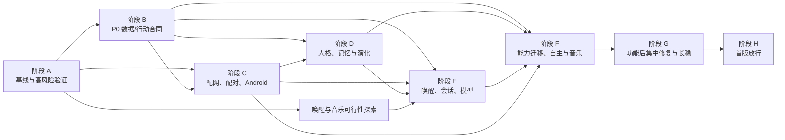

# 18 · 开发计划、任务拆解与验收门槛

## ★★ 2026-11-19 灵魂层 v2 批（当前最高优先, 依据 docs/24; 顺序按 §11.4: S2.5 前置）

> **进度注记(2026-11-20)**: S1✅ S2✅ **S2.5a✅**(trait 静态层+双性格 C4, §55.17)
> + **双臂实验✅**(MiniMax M2.5, 触发层保守形态, §55.18) + **S2.5b✅**(双通道演化面
> +genesis+persona v3+校准层 D3+B-8 门控+C-10 CI, §55.22; 实施记录 docs/24 §12)。
> + **S3✅**(行为层重构 B-2: 开机反射/S31 自启退役+L2 表删除+soul_budget 分账
> +prompt v2+sim 深思模拟, §55.23; 实施记录 docs/24 §13)。下一批 S5 六维动机(B-3)。

> 来源: 用户全流程裁决(精读→需求 R1-R12→二轮调研→选型 A-D 15 项全采纳, docs/24)。
> 实施分七个子批, 顺序依赖如下; 每批完成标准=docs/24 对应节+host_tests/soul_sim 回归。

- **S1 测试先行**: emotion/drive 黄金测试接入 host_tests.sh(9 失败标 known-fail 挂账);
  soul_sim 增 R3 验收断言(三场景区分度/无单底色>50%/ethics 可达可恢复)。
- **S2 ke v2(✅§55.15)**: mood 慢层+显示合成+负性偏置; E2a 水平项迁移; ethics 解锁(docs/24 §2.2);
  表情扇区三件套(§2.3, 23 素材; 幽灵段剔除见 §55.15); 快层锚更新与语义评审同批(R4 纪律)。
- **S3 行为层重构✅(§55.23)**: 移除开机反射(BOOT_RADIO 删除)+S31 旧自启+L2 行为表
  (文件退役); 深思行动分账预算+recency 惩罚(soul_budget 新模块)+预算硬门执法;
  深思 prompt v2(silent 默认+配额可见)。偏差: 用户停止跨重启锁存/令牌桶挂账
  (docs/24 §13.2)。
- **S2.5b(原 S4 演化面)✅(§55.22)**: EMA 统计+反思跃迁+genesis 面试+persona 持久化(v3 卡+v2 兼容读)+校准层(D3 selftest)+采样对照(B-7 采样矩阵)+B-8 表情双权威门控。偏差与触发器挂账见 docs/24 §12.2。
- **S5 六维动机**: kc/ku/kf/kb 四维+显著性仲裁器+令牌桶(§4); 黑板因子来源/TTL(L3);
  ki 五通道修复(L7)。
- **S6 注入+校准**: 叙事化状态块+结构化输出状态机+MCU 容错解析; soul_calib+promptfoo
  CI 门禁+回写三断法。
- **S7 文档终验**: docs/17 合同逐条对照+FR 追踪矩阵更新+烧录批(与配额修复合并, 择时)。

## ★ 2026-11-18 v2 计划：能力域路线（执行依据, 取代下方全部旧拆解; 灵魂层 v2 批优先插入）

> 依据: §53 开放问题清单 + 模块完成度评估（设备侧单机智能成型; App=0; 唤醒词外部依赖）。
> 排序原则: 网络稳定是钥匙 → 验收补齐择机 → App 与语音/人格并行 → 外部依赖随缘 → 终验放行。

### P1 网络稳定批（✅实质关账 2026-11-19; 目标: 电台可随时启停）
- **✅A1 修复关闭(2026-11-18 晚, §55.7)**: v6.1 内存分区 + ×10 压测 10/10 + 59min 场景 1h 浸泡存活。
- **✅A1a 余量加固关闭(2026-11-19, §55.13)**: lwip→PSRAM 找回(§25 配置回归)+hosted DMA 补丁
  (main/patches, mempool 15872→EDMA PSRAM)——×10 实测 dma_largest 恒 **40,960** 零漂移
  (旧 16,384~17,408), internal_free 26.6K→**67K**, TLS 0 错; 红线语义降级(docs/22 §3E)。
- **B2 开机电台 ✅板验→⚖️已裁取消(2026-11-19 R6: 开机自播移除, 待 S3 实施)**: 历史板验见 §55.13。
- 择机项: A1b esp_hosted RX 失败重试退避(风险已大幅收敛, 维持最低优先)。
- 测量/执法工具已就位: CLI `mem`(boot 自动审计; CLI 已双通道 UART0+USB-SJ, §55.7)。
- A1a HLS/TLS/HTTP 接收缓冲去内部化(mbedtls IO caps→PSRAM 可配、esp_http_client 缓冲、GMF 块 caps)
- A1b esp_hosted RX dma_alloc 失败改重试退避(评估社区 patch vs 本地 patch)
- 验收: 按需开电台×10 次网络存活; 原 59min 场景(soul 无聊)复跑 1h ping 全通;
  量化口径=开电台窗口 `mem` 审计 dma_largest ≥16384 不击穿(docs/22 §3E)
- 解锁: B2 开机电台、电台域验收、72h 长稳的前置

### P2 验收补齐批（✅2026-11-18 关账, §55.8-10）
- ✅A2 faceperf×4 已测收口——**方法学裁决为平台上限 1000/T(去 delay)**: 复杂 22.0~23.6fps(P95)≥15 ✓;
  简单 P50 36.5~37.3 ✓/P95 21.7~24.4 未达 30(尾源=LVGL loop 抖动, 优化专项在册); 旧 33/66ms 口径作废
- ◐A3 SD 热载坏文件: BAD_FILE+名称校验✓; 4 码冻结(变体+生成器已入库, §55.8-9; 复测=S31 板窗或按
  §55.10 姿势重做投放)
- ✅A4 镜像定性: CO5300 驱动 v2.1.0+ 支持 mirror/swap_xy(现装 v2.2.0), 待 S31 眼见
- ✅E3: issue 草稿 tools/upstream/esp_lvgl_port_pie_issue.md(用户审阅后发布)

### P3 Android App 里程碑（2026-11-18 需求重构: 安卓主线, 首版=配置功能）
> 用户决议: ①安卓为 App 主线(纯最终能力对比: 手机独占生活覆盖+触达两轴, PC 算力轴被云优先架构中和,
> PC 定位为未来可选"能力插件"走同一协议接入, 不需要现在做); ②首版只实现配置功能; ③LAN-only 维持
> (远程触达/云中继不重开)。App v1 = 纯前台工具型: 零后台任务、零云组件、权限面最小。
- **v1 范围(配置版)**: FR-01 首配(SoftAP+WiFi 投递)/FR-02 配对(pair.h 协议 App 侧+Keystore 存客户端密钥)/
  FR-04 云凭据(ASR/TTS/LLM profile, **v1 核心价值**)/FR-05 概览(最小版)/FR-06 基础设置(设置面按设备侧
  盘点定案)/FR-03 可达性(最小版: 可达/不可达+修复指引)。
- **v1 明确不做**: 记忆页(FR-26)/角色页(FR-22/23/24)/唤醒词入口(FR-31/34)/手机生活感知/远程触达
  ——后续 App 版本另行讨论需求; 推后只改交付次序, 不改 docs/16 必交性。
- **设备侧基础(已板验)**: T15 配对全链(SRP-6a+PIN 窗口+指纹表, §25)+T17 管理端点 `/v1/mgmt/*`
  (mTLS 客户端证书+credstore+412 版本冲突, §27)——App 侧直接对接, 真缺口=T16 App 本体与 T03 SoftAP 配网。
- **技术口径**: Kotlin+Jetpack Compose(docs/17 §9.4); minSdk 暂定 29(建工程时按验收真机调整);
  SoftAP 配网=network_provisioning Security2(SRP-6a 内核)+复用 espressif/esp-idf-provisioning-android
  传输层(封装 Android 扫网/加入 SoftAP 的跨版本碎片化); LAN 配对/管理=现 pair.h+/v1/mgmt/* 合同,
  docs/17 §9.2 二维码+高熵秘密留 v2(§9.2 已加 v1 注记)。
- 子阶段: **P3a** ✅(2026-11-18 深夜, §55.11)——官方 ESP Provisioning app(用户安卓真机)端到端
  全通: SRP-6a 握手+凭据投递+免闪断收窗+重启沿用(using stored creds); 五观察点全收(窗口期
  dma largest=22528 未击穿红线, memcheck PASS)
  → **P3b** App 骨架(T16): 发现/配对/概览/可达性 → **P3c** 配置页: 云凭据+基础设置+版本冲突呈现。
  **用户决议(2026-11-19): 安卓设备端开发整体延后**(P3b/P3c 挂起等开工令; 地基 P3a+appsim 已就绪,
  随时恢复); S31 暂不处理仅保证同步编译 pass。
- 验收口径: docs/17 §9 协议合同(§9.2 以 v1 注记为准)+各 FR 验收句; 至少两种 Android 版本真机。

### P4 语音域完善（与 P3 并行）
- B1 连续多轮解封(随 P1 合批) + FR-09 板验(≥5 轮)
- C4 AEC 接通评估(FR-10 打断) + D7 唤醒误唤醒率实测(≥100 正样本+24h 负)
- D11 音色预设+角色默认真实生效(T32 尾) + C1 TTS 调制消费点修复(合并做)

### P5 人格域收口
- D4 演化查看 UI(依据只读+性格日志; 最高原则: 暂停/回滚/授权不设立) + D5 AI 草稿确认流(FR-23)
- D6 敏感记忆额外确认(FR-27, 方案已录 §41)

### P6 音乐域收口（依赖 P1）
- D8 网易云点播端到端验收(FR-19) + **B2 ✅板验→⚖️R6 已裁取消(待 S3 移除, §55.13 历史记录)** + App 电台浏览(FR-18 App 侧, 随 P3 延后)

### P7 外部依赖域（随缘推进）
- D3 自定义唤醒词全链(训练站核实后: FR-08/32/33) / D9 第二 LLM 实测 / D10 Realtime S1

### P8 终验放行（D12; 依赖 P1-P6 主线完成）
- 72h 混合长稳 + 受控断电回归 + FR/NFR 放行审查(docs/21 清单) + 收尾检查(串口/仓库/进程净)

### 持续项（择机清偿, 不占里程碑）
- C2 任务登记纪律 / C3 租约矩阵 / C5-C8 低危债务(§53 C 表)

---

## 2026-11-17 修订：本文件的任务拆解已被取代（其下 8 任务冲刺亦已完成历史使命, 见 docs/19 §52）

- 曾以 8 任务冲刺(.kiro spec, 2026-11-18 随 .kiro 目录移除, 记录摘录于 docs/19 §51; 根因与修复详见 §52)为执行依据; 冲刺结论: 冻结证伪/表情 EFC+PIE 根治(v5)/网络失效根因闭环(§52.8)。
- 下文的任务编号、阶段与状态表已取代。原文保留供追溯，不再更新状态。
- 2026-11-18 终局: DCDC 判定已改判软件根因已修复(§50); 网络失效已根因闭环(§52.8); v5 固件 1h 回归表情/内存域零崩溃。
- 八项任务状态（截至 2026-11-18 03:00）：依据 docs/19 §51 H 节(原 .kiro STATUS 摘录; .kiro 已于 2026-11-18 移除)。编号与 `tasks.md` 一致，名称按 H 节。
  1. 冻结复核：2 小时串口未复现；Wi-Fi 失效观察到 1 次；未关闭，待用户。
  2. 表情 EFC 代码：宿主（PC）与设备端已实现；构建与宿主测试见状态文件 A 节；偏差见状态文件 B 节（待确认）；删除待确认。
  3. 烧录 F' 与上电核对：已完成（F' 为 2026-11-17，F'' 为 2026-11-18）。
  4. 验收与性能：用户目视验收（F'）通过；splash 时序（F'）通过；性能未测量。
  5. 条件任务：性能优化。未执行。触发条件需要测量结果，目前没有。
  6. 条件任务：冻结诊断与修复。JTAG 抓取一次（2026-11-18），结果见状态文件 E 节；DCDC 由用户判定；Wi-Fi 失效未分析。
  7. 文档同步：本次更新（2026-11-18）；之后做一次文档与代码核对。
  8. 收尾检查：未开始；依赖任务 4–7 和用户决定。

> 版本：设计草案 v1.0｜日期：2026-11-13。
>
> 这是从当前代码到 P4C5 长期使用原型的**计划，不代表已执行**。需求与边界见 [16](16_产品需求规格与功能边界.md)，实现合同见 [17](17_系统软件详细设计.md)，已发现问题及证据见 [15](15_架构与脑科学方案审查报告.md)。
>
> 首版硬要求：Android 局域网管理、设备直连用户自备云服务、连续多轮、默认 Hey Cube 与自定义唤醒词、网易云个人原型 + 电台、多角色隔离记忆和受控自主演化、统一可扩展 AI 行动、自主默认开且勿扰默认不启用。首版只以 **P4C5** 为实现和验收目标。

## 0. 计划怎么读

- 每项任务列出**编号、前置、实施内容/产出、完成证据**；阶段编号只是组织方式，完整依赖以任务表为准。可用替身并行，但不能把替身演示写成真实闭环。
- 验收类型：**R** 文档/代码/权限审查；**H** 使用虚构数据的宿主测试；**F** 故障注入；**P** P4 真机；**A** Android 真机；**S0** 服务替身；**S1** 用户授权的真实第三方服务；**U** 自愿参与的真实使用评价。
- 数字阈值除用户明确要求外均为**本计划建议的启动门槛**，不代表实测结果或科学常数。每次测试记录设备/固件/依赖版本、输入、样本、时长、原始计数、失败和限制；样本量不等于对未来的统计保证。
- 新增功能默认值必须遵守产品已确认选择。开发期可在隔离环境禁用危险通道，**不能把这种测试隔离当作首版默认关闭自主**。
- 本计划覆盖目前已确认必交功能。此前提出的客户自定义/声音复刻方向仍保留，但其是否列为首版必交尚待裁决（`docs/16 A-12`）；若列入，须先补充模型/语料权限、费用、隐私、实现任务及验收，不能按现有 48 项宣称已覆盖。
- 真实设备 SD、真实云凭据、真人音频、网易账号、实际付费或在线训练均需当次范围内许可；本规划阶段不执行。用户凭据不写入文档、样例、仓库、诊断日志。
- 严禁未经检查删除/覆盖用户文件；涉及真实旧记忆先取得许可、只读备份，仅对副本操作；报告未能恢复的内容。提交、推送、烧录和不可逆安全配置需另有明确授权。

## 1. 现状与优先级原则

### 1.1 本次计划的基线

- `docs/15` 对实际源码与合成测试发现：记忆恢复字段错位及后续写回可能丢失原用户文本、提示块越界、非严格原子文件替换、动作路径旁路、勿扰可能停止用户主动播放等。越界是**宿主合成复现**，不是已证明在 P4 上发生的崩溃。
- 现有固件有音频混音、WakeNet、级联云语音、播放器、表情和 soul 原型；它们不等于完成连续对话、可信人格隔离、真实执行回执、完整配网/Android 或自定义唤醒。
- 现有网易云设备代码直连社区 weapi 的游客搜索/取址，不必依赖独立 Node `ncm-api`；许可、URL、媒体传输安全与服务可用性仍待确认，见 `docs/17 §12`。
- P4 分区表当前为 factory app + model + storage，不包含现成 A/B OTA 槽，不能无规划宣称安全 OTA。
- 现有 `tools/check_layers.py` 遇未登记组件会跳过；旧文档的层级约束与实际组件覆盖需要同步治理。

### 1.2 用户已决定的修复节奏

**先功能，后集中处理**：已有动画/音频卡顿、低概率黑屏/静默挂死、快线语音尾音噪音、SD 偶发短读、表情热载泄漏等仍在功能完成后统一修复（阶段 G）。

但记忆数据损坏、越界、权限/隐私、用户停止不能生效以及阻断安全接入的并发问题是**扩展和试用门禁**，不属于可以积累到最后的普通体验优化；先修其最小安全子集。若现有卡顿等在功能开发途中直接造成数据破坏或危险行为，先隔离或修复必要的安全部分，并如实记录例外。

## 2. 阶段与依赖总览

阶段图表示**联调/验收依赖**，不是所有开发都必须整阶段串行：例如 C 的界面原型和 D 的合同可提前使用替身开发，但 C 的真实密钥存储需 B 的可靠存储设计，E 的会话隔离需 D 的角色合同。具体依赖以任务表为准。

| 阶段 | 目的与可交付 | 阶段门 |
|---|---|---|
| A：基线和探索 | 冻结需求、风险、威胁和旧行为清单；并行验证 P4 配网、KWS 运行时、点播链/授权。 | 不把未证实的服务或数据视作已有能力；风险有责任人和实验计划。 |
| B：P0 与动作骨架 | 安全存储/状态、能力注册、策略、资源仲裁、回执与用户控制；先用合成数据。 | 宿主 P0 回归、越界/断电/越权与行为旁路负向测试通过。 |
| C：连接与 App | 首配、物理确认、已认证加密管理通道、Android 服务配置与恢复。 | P4+Android 从空白配置可配对、换网和撤销；凭据不明文暴露。 |
| D：角色、记忆、演化 | 隔离、版本、授权、来源、检索、删除、可查看和可回滚演化。 | A/B 角色隔离、撤销/删除/重启与晚到结果负向通过。 |
| E：唤醒与对话 | P4 默认和自定义模型完整链、连续会话、LLM profile 与真实工具回执。 | 默认+自定义词真实声学验收，至少一次自定义从外部训练到激活的完整链可复现。 |
| F：伙伴体验与内容 | 把所有行动入口迁入统一门、打通可扩展自主行为、音乐电台和角色体验。 | 所有首版功能在受控环境端到端闭环；无 P0。 |
| G：集中修复 | 按既定顺序处理黑屏/挂死、卡顿、短读/泄漏、快线尾音，并做混合负载长稳。 | 修复后通过回归和资源/可靠性验收。 |
| H：放行 | 核对所有 FR/NFR、许可、隐私说明、测试证据和未决问题。 | 不用模拟或旧短测冒充真机；阻塞项未完成不放行。 |

### 2.1 关键依赖摘录与可并行事项

下列是依赖关系的摘录，不是基于任务工期计算出的严格关键路径；完整依赖以任务表为准。

- 数据依赖摘录：`T02 → T06 → T07 → T08 → T20 → T21 → T22 → T23 → T24 → T48`；人格 `T19`、设备加密方案 `T14` 及 App `T16` 在相应任务处汇合。
- 行动依赖摘录：`T05 → T09 → T10 → T11 → T12 → T13 → T34 → T37 → T38 → T48`。
- 唤醒依赖摘录：`T04 → T25 → T26 → T27 → T29 → T48`，`T28` 也在 `T29` 前完成；**T27 必须能从用户获取第三方训练模型到 P4 激活**，仅一个文本框或任意导入页不算完成。
- 连接依赖摘录：`T03 → T14 → T15 → T16 → T17/T18 → T48`；物理确认和信任建立不可用 UI 假数据替代。
- 音乐依赖摘录：`T05/T34/T35 → T40/T41 → T48`；电台不能替代网易云原型，遇实际权限/条款不允许则点播首版阻塞。
- A 阶段的唤醒、配网、内容权利、威胁调查可并行；B 的记忆和行动两条可并行；Android 界面、模型适配、能力适配可在**合同稳定后用替身并行**。G 中根因调查可并行，但集成回归以最终固件完成。
- 若 P4 推理、配网、网易接口或许可探索失败，立即记录选择/阻塞并调整方案；不将首版必须功能静默移至后续。

## 3. 阶段 A：基线与高风险探索

| ID | 前置 | 输入 → 任务/产出 | 验收证据 |
|---|---|---|---|
| T01 | — | `docs/10–17`、已跟踪代码 → 产品默认值、模块、数据流、入口和风险台账；确定测试介质与授权边界。 | **R**：区分现状/目标/待测；所有 FR 和主要入口均有责任人，文档不含真实凭据。 |
| T02 | T01 | 记忆错位、越界和文件替换问题 → 合成回归语料、原卡禁写及只读备份/迁移方案。 | **H/R**：原复现可在隔离替身上复现，逐字段样本有可比较预期；真实卡操作另行授权。 |
| T03 | T01 | P4+C5/Android → 验证无既有 Wi-Fi 凭据时 SoftAP 配网、STA 切换、Android 连接与本机触摸；验证 C5 测试凭据保存及删除路径。 | **P+A**：测试空白板从未配网到局域网可发现；换网/清除后按实际 C5 状态核验，记录 SDK/手机/断连/失败，不借用 S31 蓝牙假设。 |
| T04 | T01 | 候选开源唤醒运行时及可取得的训练模型 → 在 P4 跑实际前处理/推理，检查算子、流状态、内存、CPU。 | **P/R**：模型确实对音频推理，记录版本/许可、资源及不能兼容项；不只测组件能编译。 |
| T05 | T01 | 威胁、内容链及服务规则 → 动作风险分级、第三方/网易个人原型条款与传输边界。 | **R**：未知条款标未知；明确直连 weapi 现状、游客限制、曲库权限、临时 URL 和不建立公网后台。 |

## 4. 阶段 B：P0、数据可靠性与统一行动基础

| ID | 前置 | 输入 → 任务/产出 | 验收证据 |
|---|---|---|---|
| T06 | T02 | 旧读写和有界提示构造 → 修正加载字段、容量/分配失败及越界；移除持久身份/用户数据场景的 NVS 初始化错误自动整区擦除，源数据和恢复副本保持隔离。 | **H/F**：原错位与 ASan 复现转绿；中文/制表符/最大长度/损坏行逐字段往返，建议 ≥1,000 组随机/边界，无 ASan/UBSan 报错；模拟 NVS 失败不会自动清除用户数据。 |
| T07 | T06 | 双槽/日志恢复设计 → 版本、长度、校验、提交标记、失败回滚及存储单写 owner。 | **H/F**：每个提交点注入短写/失败/重启；恢复到可验证提交代或显式报错，不能静默空库或覆盖旧数据。 |
| T08 | T03、T07 | P4 hosted DMA 初始化与 SD → 存储状态机、延迟挂载、重试、缺卡/满盘/损坏保护；不把空视图当空库。 | **H+P/F**：专用卡无卡、满盘、迟挂载、I/O 错误、分配失败可见且禁危险写；不自动格式化。 |
| T09 | T05 | 所有动作入口清单 → `CapabilityDescriptor/ActionRequest/Receipt/Plan` schema、风险和版本合同；同步实现新层表、CMake 和未知组件检查。 | **H/R**：未知能力/无权限/错误参数被拒；新增测试能力不改仲裁核心；故意引入未知组件、循环/越层和未声明公开依赖时层检失败。 |
| T10 | T09 | 所有权和优先级 → 有界请求队列、资源租约、用户停止 epoch、幂等及真实状态回执。 | **H/F**：并发/队列满/重试/取消/晚到不重复副作用；伪造来源/优先级/空资源被拒或忽略；重启、过期和 unknown_outcome 不自动重放；`queued/accepted` 不被当作 `started/completed`。 |
| T11 | T09、T10 | 输出与工具提案 → 严格 JSON/schema、有限计划、证据 ID、TTL、执行前复检和受控确认。 | **H/F**：恶意提示、重复键、非法数/NaN、超长、伪引用、过期、角色变更均拒绝或失效。 |
| T12 | T09–T11 | 所有来源策略 → 自主总开关/分类、用户指令优先、默认勿扰关、资源级停止锁存及持久化失败安全恢复。 | **H/F**：默认自主开；关闭覆盖反射/评分/慢思考/调试旁路；用户音乐不因勿扰停；停止意图逐写点掉电/失败和重连时不复播，失败状态可见。 |
| T13 | T09–T12 | 当前会话/播放器/触摸/CLI/技能/开机反射等入口 → 行为桥接与 P0 最小修复。 | **H/R**：列举全部入口并通过共同规则；紧急停止可直达但走停止安全契约；状态因果不靠时间窗口猜测。 |

## 5. 阶段 C：设备信任、配网与 Android

| ID | 前置 | 输入 → 任务/产出 | 验收证据 |
|---|---|---|---|
| T14 | T03、T05、T07 | 威胁模型与设备能力 → 设备身份、持久密钥、存储加密、配对与丢失恢复方案。 | **R/H**：区分 flash/NVS/SD/secure boot；密钥、失钥和物理访问威胁有说明；eFuse 不擅自操作。 |
| T15 | T03、T14 | P4 物理触摸、二维码/设备公钥及安全配网 → 限时确认、App 绑定、互认证、撤销/重新配对和敏感动作确认令牌。 | **P+A/F**：未配对、伪造来源、错误指纹、重放/过期及撤销客户端不能管理；一次性确认绑定参数/人格，改参/切角/超时/重放均拒绝；合法手机可换网恢复。 |
| T16 | T15 | 已认证协议和版本化 schema → Android 配对/发现/设备概览/重连骨架。 | **P+A**：至少两种 Android 系统版本实测；Wi-Fi 切换、权限拒绝、设备掉线可理解且可恢复。 |
| T17 | T14–T16 | 用户自备服务凭据 → 安全输入、设备存取、轮换/删除、服务配置、设置版本冲突与授权说明。 | **H+P+A+S0**：抓包及日志/存储检查不见测试密钥明文，错误证书/无效 token 被拒；C5 凭据清除实测；双手机并发修改返回版本冲突、当前值/来源/生效状态可见。 |
| T18 | T08、T15、T16 | Wi-Fi/云/SD/时间/能力状态 → 设备断网屏幕、App 故障与恢复；区分唤醒监听、会话采集、向云发送的状态说明。 | **P+A**：断网、服务失败、SD 缺失、未校时及三种音频隐私状态分别展示；恢复不自动复播用户停止的音乐。 |

## 6. 阶段 D：人格、记忆与演化

| ID | 前置 | 输入 → 任务/产出 | 验收证据 |
|---|---|---|---|
| T19 | T07、T11、T12 | 角色模型与 `persona_epoch/consent_epoch/data_epoch` → 预设、自定义、AI 草稿确认、切换屏障和隔离数据域。 | **H+P+A**：A→B→A 后配置/记忆/缓存/行动/晚到结果不串；角色改名 ID 不变，草稿未确认不生效。 |
| T20 | T06–T08、T14、T19 | 本地 SD 角色存储与授权 → 经验证的设备绑定认证加密、事件/偏好摘要、来源及敏感待审写入；默认不存录音。 | **H+F+P**：测试数据在 SD 不为明文，篡改认证失败、nonce 不重用、密钥缺失 fail closed、重启可恢复；授权关闭/坏卡/写满不越权写；合成凭据不得进入记忆/演化/日志；未确认写入不虚报成功。 |
| T21 | T11、T19、T20 | 当前 query 与文字记忆 → 先权限过滤后按当前问题检索、标注来源并防提示注入。 | **H**：冻结的合成中英正负样例可复现；伪系统指令/虚构记忆 ID 不得取得额外工具权限。 |
| T22 | T02、T07、T16、T19–T21 | 模拟旧 TSV/NVS 副本 → 未归属隔离、来源映射、App 选择归属/确认/中止、逐字段校验和可回滚迁移。 | **H+P+A/F**：专用卡合法行逐字段一致；异常保留、重复执行幂等、删除后再导入不得复活；不改原文件；真实数据需另行许可。 |
| T23 | T16、T19–T22 | 用户授权与记忆操作 → App 查看/分页、暂停/恢复、纠正/删除和敏感额外确认。 | **H+P+A/F**：删除先逻辑失效；独立意图提交前断电/不可写时明确拒绝，提交后 pending/双槽回退/旧数据重导入/演化回滚/晚到动作均不复活；控制分区不可读 fail closed；物理/云删除限制可见。 |
| T24 | T12、T19–T23 | 可追溯反馈与角色边界 → 语言、行为/表情、伙伴兴趣、互动风格的有界演化与版本回滚。 | **H+P+A**：自主运行不需逐次确认；可暂停/查看依据/回滚，安全隐私和用户锁定不可被更改；跨角色不串。 |

## 7. 阶段 E：唤醒、连续会话与云模型

| ID | 前置 | 输入 → 任务/产出 | 验收证据 |
|---|---|---|---|
| T25 | T04、T08、T10 | 目标 KWS 运行时 → 单一麦克风 owner、16 kHz 管线、模型包校验、候选/已激活槽及内置 Hey Cube 回退。 | **H+P/F**：输入特征/流状态/算子与训练模型一致；坏包、缺卡、双槽均损坏、重启和中断时保留旧模型或恢复可运行的内置 Hey Cube。 |
| T26 | T04、T25 | 有来源、许可可核验的训练工具/数据 → 默认 Hey Cube 目标模型。 | **R+H+P**：模型、训练素材和运行时版本/许可可追溯；可实际加载推理，声学质量由 T29 决定。 |
| T27 | T16、T25、T26 | 第三方在线训练站 + 用户获取模型 + Android 导入/删除 → 模型兼容检测、必要可信转换打包、P4 安装/测试/回退。 | **P+A+S1**：至少一个用户自定义新词完成真实生成→取得→导入→设备唤醒→确认激活；App 展示训练路线、当前可得的费用/隐私/许可与服务可用性（未知即标未知）、生成/等待/安装/测试状态；删除活动模型先切回内置默认；失败/坏包/缺卡或双槽损坏均回退并可见。若站点需用户音频先取得明确许可，不代替用户上传。 |
| T28 | T10、T13、T19、T25 | 唤醒/ASR owner/用户控制 → 连续多轮、VAD、ASR/TTS 生命周期、停止与角色/会话代次。 | **H+P**：至少 5 轮无需重新唤醒；超时结束停止会话采集并恢复唤醒；各状态取消后无旧声/双占麦/跨角数据。 |
| T29 | T25–T28 | 默认与自定义模型 + 音乐/TTS/真实声学 → 检出、误唤醒、自唤醒、并发资源报告。 | **P+U**：建议每模型 ≥100 次正样本、尽量覆盖 ≥10 位自愿说话者；负样本 ≥24 小时、给出每小时误唤醒和置信区间。启动目标检出 ≥90%、实测误唤醒率 ≤1 次/8 小时；样本不足标待测，不声称零误唤醒。 |
| T30 | T11、T17、T21 | 服务商接口与用户配置 → LLM profile、模型/接口可切换，保留 ASR/TTS provider 可替换边界。 | **H+S0**：至少两种模拟 profile/兼容配置切换、回退与权限测试；真实服务逐项验证，缺工具能力时安全降级。 |
| T31 | T11、T13、T28、T30 | 云消息、记忆、工具提议 → 有界工作上下文、工具回执与取消、provider 线程生命周期。 | **H+P+S0**：多轮语境和结果准确；超时/切人格/撤权限后旧请求不发声、不修改记忆、不重复工具。 |
| T32 | T18、T28、T30、T31 | 云错误、预设音色及可选 Realtime → 男女预设音色选择、角色默认和 `longanrou_v3` 默认目标，限流/断流/错误凭据/快慢线状态。 | **H+P+A+S0/S1**：音色选择和角色默认真实生效，不可用时提示；故障不重复执行或切到未授权供应商；Realtime 未通过同等合同前不作为已完成。 |
| T33 | T21、T28、T30、T31 | 模型标注集与多 profile → 格式/引用/动作/角色一致性、语气与偏差评估。 | **H/R**：按模型/版本报告准确项、误差、未知与样本；LLM 自报 confidence 不视为校准。 |

## 8. 阶段 F：伙伴体验、能力迁移与音乐

| ID | 前置 | 输入 → 任务/产出 | 验收证据 |
|---|---|---|---|
| T34 | T09–T13、T31 | `app_player/app_ui/ai_skills/CLI` 等 → 音乐、语音、表情、音量能力适配，注册可用性和执行器。 | **H+P**：所有入口经共享门与回执；添加测试能力不改通用决策器；受限新参数/动作被拒。 |
| T35 | T10、T13、T34 | 单资源/混音路径 → 首 PCM 已消费为 started、排空/停止/失败为终态；播放器/话音终结协议。 | **H+P**：假设任务创建成功但不出声、数据流失败、用户打断和取消均如实返回；不提前宣称播放完成。 |
| T36 | T10、T34、T35 | 表情素材与 UI → 版本化素材目录、启动/失败/替换/结束回执，UI 线程生命周期。 | **P**：缺素材、坏素材、切片/会话并发有可用回退；自然完成为 completed、提前替换为 interrupted；热切泄漏按阶段 G 完整压测修复。 |
| T37 | T12、T19、T21、T24、T31、T34–T36 | 已知状态、记忆、人格与所有注册能力 → 候选/no-op、低频点火、参数化行动/有界组合。 | **H+P**：说话/播歌/表情共用框架；AI 设定合法参数和短组合能生效，非法参数被拒，计划中途撤权/epoch 变化按步骤停止并正确回执；新增能力无需复制自主动机。 |
| T38 | T12、T24、T37 | 用户配置与主动行为 → 默认自主 on、勿扰 off、分类控制、预算/退避和用户优先体验。 | **H+P+A**：测试设备开箱默认自主开/勿扰关且可见，修改后重启保持；各开关独立，关闭后全入口自主停止；勿扰不停止用户音乐；断连重启不恢复旧动作。 |
| T39 | T05、T17、T30、T33 | 模型版本/费用与数据策略 → 所选模型/语音服务的真实配置、错误/用量说明。 | **P+A+S1**：按用户许可的服务与配额完成真实调用，格式不兼容清晰降级；不读取或公开凭据。 |
| T40 | T05、T16、T34、T35 | 可用电台源 → App 管理/浏览电台和播放条件、用户播放/停止、错误及自主选择。 | **P+A+S1**：App 配置与浏览可用，适用条款允许的源完成播放与真实回执；网络失败可见，不能凭 URL 可达断言授权。 |
| T41 | T05、T34、T35 | 现有设备直连游客 weapi 原型 → 搜索/选曲/取址/播放、权限/版权/失败提示及内容提供者隔离。 | **P+S1/R**：目标个人使用场景、账号/曲目/播放条款有记录，至少一个允许使用的点播案例真实闭环；接口不可用/限制不能绕过；商业权利未证明即不宣称。 |
| T42 | T08、T13、T34 | 既有备忘/提醒及非首版功能 → 保留扩展边界、阻止通过遗留工具绕过策略。 | **H/R**：既有能力未静默删除；未保证的提醒可靠性明确标非必交，敏感操作不越权。 |
| T43 | T18、T23、T24、T27–T33、T36–T42 | 功能版 → Android + P4 + 所选服务的完整产品旅程。 | **P+A+S1**：首配、角色草稿确认、连续对话、记忆隔离/删除、演化回滚、默认/自定义唤醒、两类播放、断网恢复均具真实证据，无 P0。 |

## 9. 阶段 G/H：功能后集中修复、长稳与放行

| ID | 前置 | 输入 → 任务/产出 | 验收证据 |
|---|---|---|---|
| T44 | T43 | 功能完成版 + 混合负载 → P4 CPU、内部/DMA/PSRAM、栈、水位、音频与 EFC 基线。 | **P**：场景、时长、P50/P95/P99、峰值及实际配置可复现；不沿用旧单次演示作为新基线。 |
| T45 | T44 | 黑屏/静默挂死/WDT → 现场保留、最小复现及修复。 | **P/F**：建议 ≥100 次冷热重启观察无同故障；注入失败可留证，不只靠强制重启掩盖死锁。 |
| T46 | T44、T45 | 大素材卡顿/SD 短读/热切泄漏 → 解码与缓冲生命周期修复。 | **P**：以约定素材并发测帧耗时及音频欠载；建议混合负载 30 分钟无观察到欠载、1,000 次热切无持续泄漏，实际门限由基线确认。 |
| T47 | T44–T46 | 快线尾音噪音及旧声混入 → 环缓冲/重采样/终止和切流边界定位修复。 | **P+S1**：建议 ≥100 次不同末尾/中断样本无可复现异常，保留合成音频量测和自愿试听结果。 |
| T48 | T20、T23、T29、T39–T47 | 统一长稳/断电/安全/隐私回归、固件与数据 schema 升级/回退和恢复方案及 FR/NFR 放行审查。 | **H+F+P+A+S1/R**：专用测试介质验证版本兼容、授权的本地升级失败恢复，不假设 A/B OTA 或自行烧 eFuse；建议 ≥72 小时混合运行、≥100 次重启/受控断电；无已知 P0，必交证据完整。 |

### 9.1 长期断电与恢复测试专项

- 专用测试卡上覆盖提交各阶段断电、突然拔卡、满盘、设备重启、同一卡重挂、坏 manifest、旧版本和密钥不可用；逐项检查保留最后已验证提交代或明确报不可恢复，**不能承诺所有 FAT/介质故障都可恢复**。
- 使用受控时钟模拟 30/365 天、时间倒退、网络长期未连接；单调时间仅同一启动周期可用。再做至少一次实机较长断电（建议 24 小时）并记录；模拟一年不等于实际断电一年。
- 禁止重放过期动作、把缺卡视为空库、用户停止后自行复播；提醒不属于首版必交，但现有提醒不得静默越权或错误宣称已投递。
- 无真实用户 SD/旧文件授权时只用合成数据。即使通过测试也不保证已被旧版覆盖的真实原话可以找回。

## 10. 需求到任务追踪

| 需求 | 任务 | 核心验收 |
|---|---|---|
| FR-01–03 首配/局域网/断网 | T03、T14–T18、T43 | 空白配网、物理确认、撤销、断网恢复；非离线产品。 |
| FR-04–06 云配置/状态 | T14–T18、T30、T39 | 凭据不回显、C5 清除测试、服务能力和未知状态可见、设置来源与并发版本冲突、两种模拟 profile + 所选真实服务。 |
| FR-07–08、31–34 默认/自定义唤醒 | T04、T25–T29 | 默认 Hey Cube 与用户自定义词均经真实训练/导入/板测；外站可用性与许可有记录。 |
| FR-09–12 连续语音/音色/隐私 | T10、T17–T18、T28、T31–T32、T43 | 至少五轮、结束停止会话录音；男女预设/角色默认音色及不可用提示；分别展示监听/录音/云传输状态。 |
| FR-13–17 通用行动/控制/回执 | T09–T13、T34–T38 | 用户、自主和所有入口同一安全门；真实开始/终态，不可跳过停止锁存。 |
| FR-18–21 电台/点播/表情/勿扰 | T12、T34–T36、T38、T40–T41 | 两种来源真实闭环，勿扰默认关闭，用户明确播放不被自主勿扰停止。 |
| FR-22–24 角色卡与隔离 | T19、T22–T24、T43 | 草稿确认、跨角色会话/数据/索引/回执/晚到结果隔离。 |
| FR-25–28 长期记忆及敏感数据 | T06–T08、T20–T23、T48 | 授权、按 query 检索、删除防复活、SD 故障保护、无默认录音。 |
| FR-29–30 受控自主演化 | T19、T23–T24、T37–T38 | 有界自主变化、查看依据、暂停/回滚；不得修改权限/用户锁定项。 |
| NFR-01/08 完整性与恢复 | T06–T08、T20、T22–T23、T48 | 故障注入、可验证提交代、缺卡只读/禁写、长断电报告。 |
| NFR-02/03/04 安全/隐私/隔离 | T05、T11、T14–T17、T19–T23、T48 | 双向认证、撤销、日志检查、模型注入与跨角负向测试。 |
| NFR-05/06/07 性能/可观测 | T10、T25、T28–T29、T35、T44–T48 | 真实音频回执、资源水位与延迟分布；不可用虚构预算替代。 |
| NFR-09/10 可扩展/可测试 | T09–T13、T30、T34、T37、T48 | 新能力注册和模型 profile 可替换；宿主与板测各自报告。 |
| NFR-11/12/13 科学/许可/用户控制 | T05、T12、T24、T33、T38–T41、T48 | 不夸大科学结论、合法可用性有证据、产品默认符合用户选择。 |

### 10.1 验收测试用例索引

| Case | 关键场景 | 期望 |
|---|---|---|
| AC-01 | 系统开箱、无 Wi-Fi。 | 屏幕提示联网，App 通过本机确认配网；不宣称离线会话可用。 |
| AC-02 | 陌生同网设备调用管理接口。 | 认证失败，不泄露状态/密钥；重放与撤销后 token 无效。 |
| AC-03 | 用户播放电台并开启勿扰。 | 正在播放的用户音乐继续；新自主出声按规则抑制。 |
| AC-04 | 用户停止音乐后 Wi-Fi 断开重连/重启。 | 旧队列及晚到结果不复播，停止锁存可由用户显式解除。 |
| AC-05 | 自主总开关关闭。 | 本地/云慢思考/开机反射/调试桥均无自主行为；用户主动操作仍可用。 |
| AC-06 | A 角色发出慢请求，切换 B 后才收到结果。 | 旧结果不在 B 的屏幕/语音/动作/记忆出现，且不能继续执行。 |
| AC-07 | 删除记忆时正在生成摘要/动作，之后重启、回滚演化或重导旧文件。 | 持久删除意图已接受时立即逻辑失效，旧摘要/动作丢弃，重启、回滚和重导不得复活；意图无法持久化须明确拒绝而非虚报成功。 |
| AC-08 | 用户未授权或 SD 缺失。 | 长期记忆不保存；显示暂停，不静默写 NVS，不格式化卡。 |
| AC-09 | 模型提议恶意指令/非法 JSON/虚构引用。 | 解析/授权拒绝；模型不能借角色卡或记忆升级权限。 |
| AC-10 | 播放器任务创建成功但音频未开始。 | 只能是 accepted/失败，不能显示“已开始播放”。 |
| AC-11 | 手机导入不兼容或损坏的唤醒模型。 | 明确错误，保留原可用模型；不执行附带脚本。 |
| AC-12 | 用户从第三方训练新词并试用。 | 展示可得的隐私/许可/费用/服务可用性及生成/等待/安装状态（未知标未知）→ 模型取得 → 兼容打包 → App 下发 → P4 唤醒 → 确认激活；坏包、缺卡、重启或双槽损坏时返回上一可用模型或可运行的内置 Hey Cube。 |
| AC-13 | 演化被用户暂停或回滚。 | 不产生新修订/恢复指定修订；自主开关和用户安全配置不被改变。 |
| AC-14 | 云模型切换或限流。 | 未授权供应商不接收对话；配置失败清楚提示，不重复工具调用。 |
| AC-15 | 实际介质在每个提交步骤断电。 | 恢复可验证旧/新提交代，或可见错误并停止写；不得无提示空库覆盖。 |
| AC-16 | 网易目标歌曲不可用/受限。 | 如实提示，不能绕过权限或假称播放；电台可用不算完成点播。 |
| AC-17 | 夜间无校时但勿扰未启用。 | 不以未知时间额外启用勿扰；其他授权/用户停止/资源规则仍适用。 |
| AC-18 | 多轮对话自然结束。 | 停止会话录音，销毁有界临时数据并回唤醒监听；不宣称麦克风物理关闭。 |

## 11. 开发细分建议

### 11.1 每一项任务的执行模板

1. 确定需求 ID 与前置，列出现存入口和数据流；只读核查私密信息边界。
2. 写最小可运行合同和失败语义；先实现合成数据的单元、故障注入和负向用例。
3. 在隔离设置下实现具体适配器，明确迁移旧入口、关闭旁路和版本回滚；先在宿主/S0 验证。
4. 记录 P4 资源预计值与真机测量差距；需要用户配合/第三方服务时单独获得授权。
5. 更新需求追踪、测试结果、故障和限制；无真实证据标未验证。

### 11.2 代码与文件边界建议

- `firmware/components/cubecore`：共用 ID、状态和动作合同；事件只承担轻量通知。新协议可以单独命名组件，避免核心库变成业务大杂烩。
- `firmware/components/app_soul`：拆分状态、候选、慢思考和演化职责；旧 `soul_mem` 的不安全读写先修/隔离，不要求一次性重命名。
- `firmware/components/app_storage`：存储 owner、版本化恢复与故障；旧 `remove+rename` 不能作安全替换证明。
- `firmware/components/app_ai_session` / `speech_provider` / `app_voice`：会话状态、云 provider 合同及 KWS adapter；麦克风/ASR 顺序所有权单独验证。
- `firmware/components/app_player`、`app_ncm`、`app_ui`、`ai_skills`：改为注册能力/数据服务与可验证执行回执；无需让应用层直接依赖 `app_soul` 实现。
- `firmware/main`：装配注入策略和执行器；`tools/check_layers.py` 与 `docs/06` 同步支持新层表、未知组件报错、依赖图检测。
- Android：仓内当前未见独立 App；建议新建独立模块目录，Kotlin/Compose 可作工程默认，合同遵守 `docs/17 §9`，不需要公网业务后台。
- 迁移期允许桥接，但必须明确旧入口何时关掉；不能新旧双写到真实记忆或同时拥有播放器控制权。

### 11.3 模型及动作协议版本治理

- schema 增加字段必须定义默认/兼容方式；不兼容变更升版本，并维护 App/固件最低协议版本。
- 每个模型 profile 和动作 capability 都有版本与测试证据；不同 LLM 的结构化输出/函数调用能力分别标注，不以兼容 API 的名字推定质量。
- 人格变化、数据迁移和模型安装需要回滚路径与失败保护；任何把权限扩大或替换信任锚的变更要单独确认。

## 12. 用户配合与外部依赖清单

下列不是现在要立即执行的操作；按任务需要再申请对应许可，特别是数据、烧录、付费和公开上传。

| 时机 | 需要的配合 | 风险与替代 |
|---|---|---|
| T03/T15 | P4 实机、测试 Wi-Fi、Android 手机及本机触摸 | 使用测试网络与测试账户；不需要用户把密码写进聊天。 |
| T04/T25–T29 | 可用的开源运行时/第三方训练模型；自愿说话人/测试环境 | 在线训练可能公开/留存词或音频、收费或不可用；用户自行确认条款和上传，先用合成样本。 |
| T17/T39 | 测试云账户及用户配置的服务凭据 | 保留用户已提示的有限额度；先 S0，按实际计费设额度；不读取/打印/上传给其他服务。 |
| T05/T41 | 网易个人使用方式、目标歌曲及适用服务条款 | 游客可用/版权状态不确定；不索要 Cookie，不绕过权限，未经许可不承诺商业分发。 |
| T20/T22/T48 | 专用 SD、受控断电设备；若需要迁移旧真实数据需明确单独许可 | 先只读副本；禁止自动格式化和旧逻辑回写，无法恢复需如实告知。 |
| T29/T33/T43 | 自愿评价参与者、播放/语音环境 | 告知采集与云传输；用合成数据优先，报告样本不足和偏差。 |
| G/H | 对低概率黑屏/噪音/卡顿进行复现与试听 | 记录具体固件和场景，避免将未出现当成绝对证明。 |
| 更新/安全开关 | 分区调整、签名、flash encryption / secure boot / eFuse | 不可逆操作前专项评审并单独确认；当前未证明已开启。 |

## 13. 风险、时间与成本

| 风险 | 触发条件/影响 | 应对 | 关联任务 |
|---|---|---|---|
| 自定义 KWS 技术/服务不可用 | 训练站停运、模型格式与 P4 不兼容、资源超预算或误唤醒太高。 | 前置真实推理、检查前处理和许可证；保留其他开源训练路线与回退，**不取消首版要求**。 | T04、T25–T29 |
| 首配路径不成立 | P4+C5 SoftAP/STA 或 Android 切换不支持。 | 提前做空白板实验，选同等安全的可证实通道；不假设经典蓝牙。 | T03、T15 |
| 记忆损坏/隐私泄露 | 旧加载错位、SD 掉电、明文/日志、角色切换或晚到。 | 先合成重现、禁写真卡、版本/双槽恢复、身份与删除隔离；真实迁移须许可。 | T02、T06–T08、T19–T23 |
| 行动越权/误播 | 旁路、误归因、假回执、慢结果落后。 | 全入口策略、用户停止 epoch、真实回执和权限测试；产品默认自主仍为开。 | T09–T13、T34–T38 |
| 音乐服务/版权 | 社区 weapi 变动、游客受限、HTTP 媒体、授权不适用。 | 在适用范围内做个人原型，清楚说明并处理失败；商业接入另行谈授权。 | T05、T40–T41 |
| 云成本或服务不稳定 | 有限测试额度、模型不支持功能、付费或限流。 | 先替身、分服务预算/超时、用户授权真实调用，不能自动转其他供应商。 | T17、T30–T33、T39 |
| P4 综合资源不足 | 音频、KWS、EFC、PSRAM、内部 DMA 或 TLS 争用。 | 合并优先级和分场景测量，先保证资源安全/用户控制，再在阶段 G 调体验。 | T03–T04、T25、T44–T47 |
| 密钥/更新不可恢复 | 失钥、不可逆 eFuse、目前无双 OTA 分区。 | 先设计恢复/迁移和保护级别；单独评审和授权，未实测不称安全 OTA。 | T14、T48 |

### 13.1 粗粒度工作量与日历说明

当前缺少团队人数、已有 Android 资产、运行时可行性和第三方响应数据，不能给可靠交付日期。以下仅作为**规划级粗估，不是报价或保证**：

| 阶段 | 粗估人周 | 主要不确定性 |
|---|---:|---|
| A 高风险探索 | 2–4 | 第三方训练、P4 配网与音乐权利是否可用。 |
| B P0 与行动骨架 | 6–10 | 存储故障、旧入口迁移及并发复杂度。 |
| C App/安全与连接 | 8–14 | P4+C5 通道、双向认证、Android 兼容。 |
| D 记忆、角色与演化 | 5–9 | 隔离/删除、防复活及合成评估。 |
| E 唤醒/对话/模型 | 10–18 | 自定义 KWS 模型链、声学数据与资源。 |
| F 行为/内容集成 | 7–14 | 内容可用性、执行回执及体验调优。 |
| G/H 集中修复/放行 | 5–9 | 黑屏/噪音复现难度、长稳与许可。 |
| **合计** | **43–78 人周** | 粗估范围，不含外部商务等待、认证费用及大规模真人研究。 |

阶段可并行但受关键路径约束；工程师能力、可用设备和风险验证结果未确定，因此不从人周简单推导日历日期。完成 A 阶段原型实测后按实际吞吐、团队配置及外部等待重新估算。

### 13.2 成本核算方法

- 工程成本 = 实际人日 × 实际综合费率，不将假定费率当报价。
- 云成本按模型输入/输出 token、ASR/TTS/Realtime 的实际计费单位、调用次数、服务商当期价格分别计算；用户自备云凭据，试验前明确预算和配额，优先使用替身。
- 唤醒词按第三方服务政策及实际训练次数计算，数据授权、模型许可与服务可用性必须分别记录。
- 电台/网易内容的授权、会员或商务成本以实际条款/报价为准；个人原型可用不等于商业许可。
- 现有项目测试账户额度有限，不因制定计划而自动执行计费请求。

## 14. 首次进入开发时的下一批工作

在用户授权开始开发后，建议第一批只处理下列工作，不提前动真卡或付费调用：

1. **T01/T02**：冻结合同和原始缺陷合成回归，确认真实介质不被旧逻辑写入。
2. **T03/T04/T05**：并行做 P4 配网/KWS/音乐权限可行性方案；需要接板、第三方服务或用户音频时先取得对应许可。
3. **T06/T07 + T09/T10**：用合成数据建设记忆安全与统一动作/真实回执的最小骨架；不要直接扩展六维动机。
4. 完成门禁后，再沿 C/D/E/F 形成设备—Android—服务商端到端闭环。
5. 功能完成后才按 G 统一处理已记录的体验故障，并据最终版本执行 H 放行。
